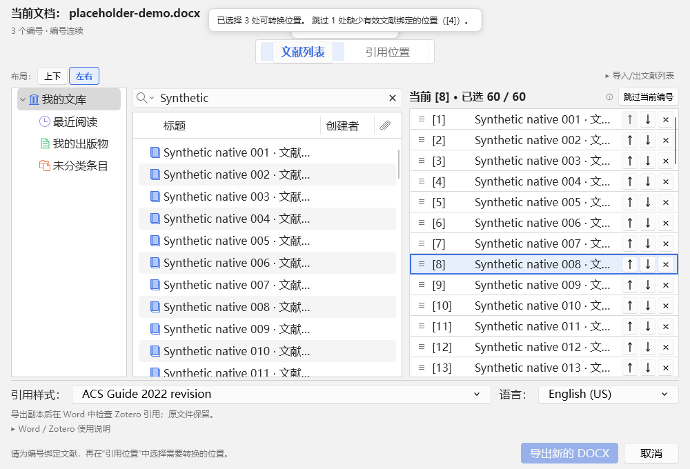

# 编号批量引用 · Batch Citations 2.0.0

把 Windows 桌面 Word 文档里的 `[1]`、`[1,3]`、`[1–3]` 等手写文献编号，批量转换成可编辑、可刷新的 Zotero 动态引用。

[下载完整安装包](https://github.com/NysaMisty/Batch-Citations/releases/download/v2.0.0/zotero-batch-citations-2.0.0-bundle.zip) · [单独下载 Zotero XPI](https://github.com/NysaMisty/Batch-Citations/releases/download/v2.0.0/zotero-batch-citations-2.0.0.xpi) · [发行页面与校验文件](https://github.com/NysaMisty/Batch-Citations/releases/tag/v2.0.0)

## 主要功能

- 扫描正文和表格里的手写编号，用 Zotero 原生资料库为每个编号匹配文献。
- 预览编号变化，勾选要转换的位置，一次插入并刷新引用。可整批撤销。
- 在 Word 里切换已有数字引用的上标或正文显示，继续使用 Zotero 原有功能编辑引用和生成参考文献表。

*界面截图使用合成文献和 DOCX 示例。*

## 安装与使用

需要 Windows 桌面版 Microsoft Word、Zotero 7.0–10.0.x，以及 Zotero 自带的 Word 插件。完整安装包包含 Zotero XPI 和本项目的 Word 加载项，请一起安装。

1. 从完整安装包解压 `zotero-batch-citations-2.0.0.xpi`，或从 [Zotero 中文社区插件商店](https://zotero-chinese.com/plugins/#plugin=NysaMisty%2FBatch-Citations) 下载 XPI，然后在 Zotero 的插件管理器中安装。
2. 关闭 Word，从完整安装包或 [GitHub 发行页](https://github.com/NysaMisty/Batch-Citations/releases) 获取同版本的 `zotero-batch-citations-2.0.0-word.zip`，解压后运行 `Install.cmd`。
3. 保持 Zotero 运行，在 Word 的 **Zotero → 批量匹配编号** 打开窗口。选中编号后双击文献完成绑定，勾选要转换的位置，再点 **插入并刷新当前文档**。

从旧版升级时，用新版 XPI 覆盖安装 Zotero 插件，再关闭 Word 运行新版的 `Install.cmd`。Zotero 的插件更新只会安装 XPI，Word 加载项仍需单独升级。

卸载时先关闭 Word，运行 Word 安装包里的 `Uninstall.cmd`，然后从 Zotero 的插件管理器移除插件。

## 工作方式

Word 加载项负责扫描当前文档、核对位置和写入引用。Zotero 插件提供文献选择、编号匹配和预览。选择文献时只保存编号映射，确认插入后才写入 Word。写入前会核对文档有没有变化，写入异常时会回滚本批操作。两个组件在本机协作。

已测环境与覆盖范围见 [测试报告](https://github.com/NysaMisty/Batch-Citations/blob/main/docs/DEVELOPMENT-2.0.0.md)。

## 欢迎反馈和帮忙测试

实现工作几乎全部由 **ChatGPT** 完成，我主要负责功能测试。欢迎在 [Issues](https://github.com/NysaMisty/Batch-Citations/issues) 提建议或报告问题。如果你愿意帮忙测试不同版本的 Windows、Word 和 Zotero，或想一起探索 macOS、WPS 等环境的适配，也欢迎留言。

遇到问题时，附上系统和软件版本、复现步骤或截图，会方便一起排查。

[MIT 许可证](LICENSE) · [变更记录](CHANGELOG.md)
