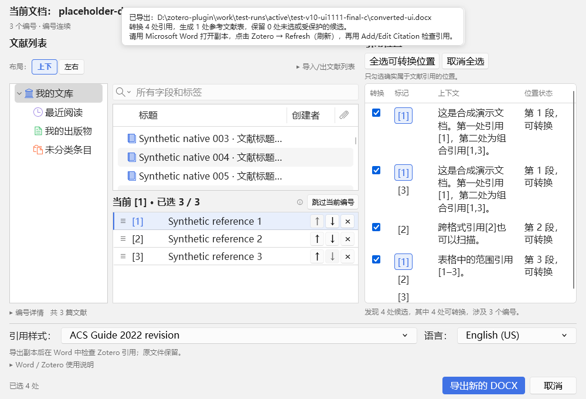
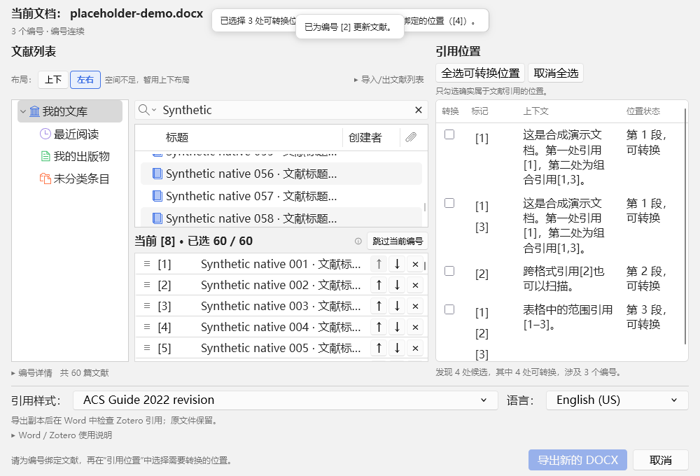
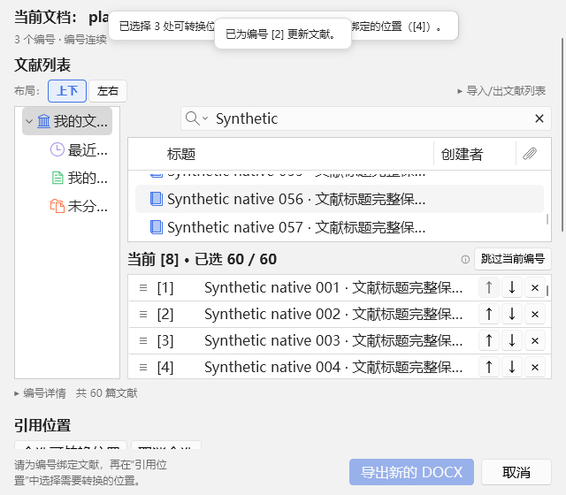

# 1.1.11 即时文献映射与双栏界面

基于正式 1.1.10（08801bd）现有源码修改。继续只维护一套源码，保留原生资料库、映射数据结构和 Word 事务流程。

## 原有控件职责

文献选择器已嵌在主窗口中，没有独立编号下拉框。原编号队列和编号详情行均可进入选择，但编号文字没有同等操作。原“加入并继续”只修改 OrderedSession 草稿，“应用文献列表”通过 onApply / applyMappingChanges 提交内存映射，“取消本次选择”恢复草稿基线。它们均不直接写 Word；Word 写入继续由“插入并刷新”提交。

## 最终交互

引用位置中的编号、编号队列的编号与标题、详情中的“选择文献”共用当前目标。编号具备键盘 Enter/空格、悬停、当前状态高亮；两个相邻选择入口共用处理函数并停止冒泡。没有第二份独立编号选择状态。

选中一篇有效的原生 Zotero 文献后，立即解析当前 URI、确认必要的跨编号复用并保存对应编号。删除三个按钮和按钮栏，以及等待手动应用的 dirty 状态。清除、替换和排序同样立即生效；原来选入后前进到实际下一个未匹配编号及显式跳过继续保留，不另加跳转规则。

每个原编号仍映射一篇文献；同一引用位置中的组合/范围编号继续支持多篇文献。多个原编号复用同篇仍默认取消确认，保留全部原标签，引用簇按稳定身份去重。

## 状态与安全

串行变更使用独立候选 OrderedSession，捕获目标编号并只提交稀疏变化；省略标签保持原样，null 表示清除。统一验证新增和排序变化，重复检查包含清除项，避免移动到空槽误报重复。显式目标修订保留验证期间的用户导航，清除/排序保留原有目标跟随行为。

原生选择与激活事件去重。校验、确认框和提交后的每个异步边界检查快照修订；旧快照成功或失败结果不能覆盖新状态。失败保留旧映射并显示原因；父视图刷新失败也恢复原映射。提交完成即时刷新文献详情、引用位置可转换状态和统计。

Service 保存同次 Zotero 运行中已应用的 UI 映射，按文档身份和完整指纹隔离，关闭重开相同未变文档时恢复。新快照不会使用旧指纹缓存，插件关闭清空缓存。尚未插入 Word 的映射如需跨 Zotero 重启保留，使用现有导出/导入；已插入的绑定仍随 Word 文档保存。

自动保存映射不调用 Word 写入或计划提交。已引用标签保护、原生引用、最终插入前重校验、文档指纹、范围、事务、核验、回滚与撤销沿用既有实现。

## 布局

复用原有两个面板，把页签容器改为共享四条 Grid 轨道的双栏：标题、操作、主要内容、摘要。实际内容区顶部和底部共用轨道，内容在各自区域内部滚动。面板高度随可用空间增长；只设最小可用空间，等高关系来自共享轨道。窄于 720px 时上下排列，主内容允许补充滚动，底部主操作固定可见。

删除选择按钮栏的空轨道，保留原生资料库/编号队列的上下、左右偏好及窄屏回退。标题优先显示当前编号，长统计省略并提供完整提示。编号详情按需浮层展开，不挤压两个主要窗口；原生字体、颜色、边框和明暗主题保留。

## 文件

- addon/content/picker.js：即时验证提交、队列、去重、目标与错误处理。
- addon/content/dialog.js：统一目标、即时刷新、父级提交回退及会话映射恢复。
- addon/content/live-service.js：按文档身份和指纹隔离的会话映射缓存，协议未变。
- addon/content/dialog.xhtml、dialog.css、picker.css、picker-layout.js：双栏共享轨道、滚动和布局回退。
- addon/content/mapping.js：清理要求点击已删除按钮的提示；底层映射能力保留。
- Node 与真实宿主测试、版本工具覆盖文件、README、AGENTS 和验收文档同步更新。

## 验证与覆盖范围

最终证据由 [发布输入](test-results/release-inputs-1.1.11.json) 指定：[发布核验](test-results/release-proof-1.1.11.json) 已通过最终 addon、DLL、问题文档基准和恢复记录的逐项对照。最终轮次为 UI final-c、真实 Word final-g、窗口生命周期 final-c、独立 Word final-c。

| 检查 | 实际结果 |
|---|---|
| 完整 Node 回归 | 199 通过，0 失败、0 跳过 |
| 原生界面、即时映射、DOCX 和布局 | Zotero 7.0.32 / 10.0.7 各 101 通过 |
| 真实 Word 完整流程 | 两版各 53 通过 |
| 窗口复用、最小化恢复和连续批次 | 两版各 63 通过 |
| 独立 Word 安全 / 完整性 / 身份管线 | 15 / 8 / 8 通过 |
| 版本、语法与构建 | 1.1.11 一致；18 个 addon JS 文件语法通过；Word DLL 与插件构建通过 |

项目没有独立 TypeScript 类型检查任务。Word 实测版本为 16.0.20527；每个宿主轮次另验证官方模板适配 7 场景并恢复临时注册及模板。导入导出 26 个界面子项包含在各 53 项内，不重复累加。

真实 Word 验证选文献后正文和字段不变，关闭重开同一未变文档保留映射且不自动勾选引用位置。两版均完成问题文档 35 个唯一位置 / 17 个原编号的插入与刷新；60 篇流程实际经过逐篇原生选择、自动映射、排序、插入 60 个原生引用域、刷新与保存重开。另验证重复标签、部分映射、缺号补齐、组合引用和最终确认取消。它们不是扫描或模拟通过。

每版 12 组布局/明暗主题几何、6 组大编号边界和 9 组主窗口几何全部通过。1000×680 下左右主要内容区顶部均为 142.17、底部均为 516.60、高度均为 374.43；实际 DPR=1。分别内部滚动，缩窄后堆叠；展开编号变化辅助预览时主内容可能需要有限滚动，底部操作仍可见。

两版自动宿主均实际取得批量窗口 OS 前台，exactDialogForeground / nativeActivation 为 true，API 错误为空；不能据此保证全部 Windows 状态。完整测试数量、恢复证据及限制见 [TESTING](TESTING.md)。

原 textdocx 路径已不存在。测试从历史 test-large115-acceptance/large-document-copy.docx 恢复基准，SHA-256 为 b729c2ea9ee879b913907c26915578d941d270fbf657119d97e00816e68d44a0，与 1.1.10 正式 Word 报告 sourceHash 完全一致；本轮仅复制基准操作，历史副本不修改。

开发期失败和旧 addon 轮次保留诊断，不计入最终通过。失败曾暴露标题被长编号统计挤压、布局固有尺寸撑开、空槽排序误判及去重/目标跟随问题，均补充对应回归修复。Word 早期 b–f 轮次另暴露基准路径、测试命令路由、辅助预览滚动断言与控制文件读取竞态；修正测试后，final-g 使用同一冻结 addon 在两版完整重跑通过。控制文件只对暂时无法读取或部分 JSON 重试，真正操作异常仍失败。

真实宿主拖拽通过 DragEvent 执行；未完成物理鼠标全程、屏幕阅读器、全部键盘路径、多 DPI、所有 Office、Windows 或 CSL 组合验收。未安装到用户正式环境，不远程推送。跨 Zotero 重启的未插入映射依赖已有导入/导出，已写入的绑定仍随 Word 保存。

## 实际界面

截图来自隔离资料库与合成文档的 DOCX 兼容模式；真实 Word 的“插入并刷新”流程由上述独立联测覆盖。

