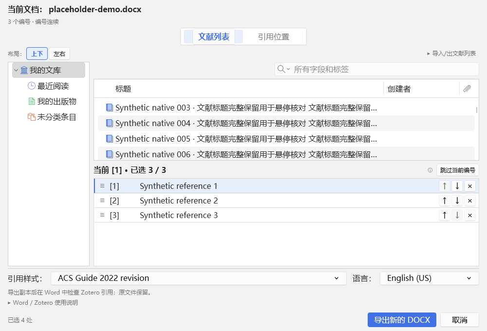

# 1.1.12 文献选择局部修正与验证

## 范围与版本判断

本版基于 Git `2cbce7f`（1.1.11）局部修正，没有执行整体回退。对照 `08801bd`（1.1.10）后，仅恢复“文献列表 / 引用位置”页签骨架，并保留 1.1.11 的即时稀疏映射、重复绑定确认、快照竞态保护和 Word 显式写入边界。1.1.11 正式包未修改。

## 实现

- `dialog.xhtml`、`dialog.css` 移除左下 `#mapping-details` 及其表格和占位空间，保留 `#zbc-picker-queue`；主面板恢复为两个独立页签。
- `picker.js`、`picker.css` 将编号队列的编号、标题及空白区域统一到行级点击和键盘入口，行级选中/悬停样式统一；操作按钮在独立区域阻止冒泡。
- `dialog.js` 保留引用位置中的编号入口，并在存在当前/历史来源歧义时复用原有确认逻辑，避免删除详情区后丢失安全映射能力。
- 单击重复绑定的根因是 Zotero 原生 ItemTree 在一次鼠标操作的按下、松开阶段都可能触发选择变化；即时提交完成后清空选中会让松开阶段再次选中同一行，自动前移到下一个编号后再次提交。现在捕获原生文献和目标编号，在任何异步验证前将该操作标记为已消费；同一操作的后续通知不再提交，下一次真实点击重新建立操作。激活通知只更新布局。
- 键盘操作在当前输入周期结束时捕获实际原生选择并失效，兼容延迟通知；未匹配字符和列表边界按键不会留下提交意图。资料库刷新、删除后的自动重选不能保存映射。提交入队时记录导航修订，用户随后显式切换编号不会被迟到结果抢回。

## 验证

最终完整 Node 回归 206 / 206 通过；版本一致性、18 个 addon JS 语法、XHTML 和构建通过。独立审查指出的未消费键盘意图已复现并修复，另补同步导航回归；相关测试先失败后通过。最终日志见 [TAP](test-results/unit-tests-1.1.12.tap)。

Zotero 7.0.32 / 10.0.7 隔离原生 UI `corr-final-o` 各 105 项通过，包含原生单击按下后等待保存、松开/点击/激活不重复绑定、错误后重试、整行选择、独立页签与缩放、排序清除、重复确认、引用识别和 DOCX 输出。每版 6 组页签几何、12 组资料库/队列排列与明暗几何、6 组大队列边界均通过。被测包与最终 addon 一致，见 [界面验证摘要](test-results/ui-proof-1.1.12.json) 和 [测试记录](TESTING.md)。

真实 Word 16.0.20527 COM 回归在 Zotero 7.0.32 与 10.0.7 下各通过 53 项，使用隔离 profile、合成资料库及测试文档。覆盖自动映射只更新映射、不修改正文或字段，关闭重开后映射保留；35 处 / 17 编号问题文档副本转换；60 篇逐项选择、排序与引用 URI 核对；部分映射、重复绑定确认、替换、撤销、混合原生引用和文献表刷新。两版临时 Word 注册及用户/官方模板均恢复，原测试文档 SHA-256 未变。摘要证据见 [Word 7](test-results/word-7.0.32-iteration-1.1.12.json) 与 [Word 10](test-results/word-10.0.7-iteration-1.1.12.json)。

首次 Word 重跑暴露测试宿主沿用了旧的 9 项布局预期；实际几何矩阵为 3 种尺寸 × 2 个页签，修正为 6 后两版完整流程通过。插件布局和 Word 写入实现未因这项测试修正而更改。最终 Zotero 7.0.32 / 10.0.7 窗口生命周期各 63 项通过；独立 Word 安全、字段完整性和事务管线分别通过 15 / 8 / 8 项。测试注册、用户模板及官方模板均恢复。自动前台采样中窗口可见、Zotero 内部聚焦正常且无 API 错误，但 Windows 前台由其他应用占用，所以 `exactDialogForeground` 和 `nativeActivation` 为 false；系统前台激活仍未验证通过。

## 交付限制

即时选择只更新当前编号映射，不写入 Word；Word 文档仍需显式执行“插入并刷新”。Word 业务源码本轮只同步版本常量，没有修改插入流程。真实 Word 已按上述隔离方式完成双版本验证；未运行窗口激活生命周期、独立 Office 安全/完整性测试，也未覆盖所有 DPI、输入设备及 Office/CSL 组合。

正式状态以 `outputs/当前版本/1.1.12/RELEASE.json` 和项目发布入口为准；本轮不自动安装到用户 Zotero / Word，也不推送远程。旧正式包通过发布流程原样归档。
