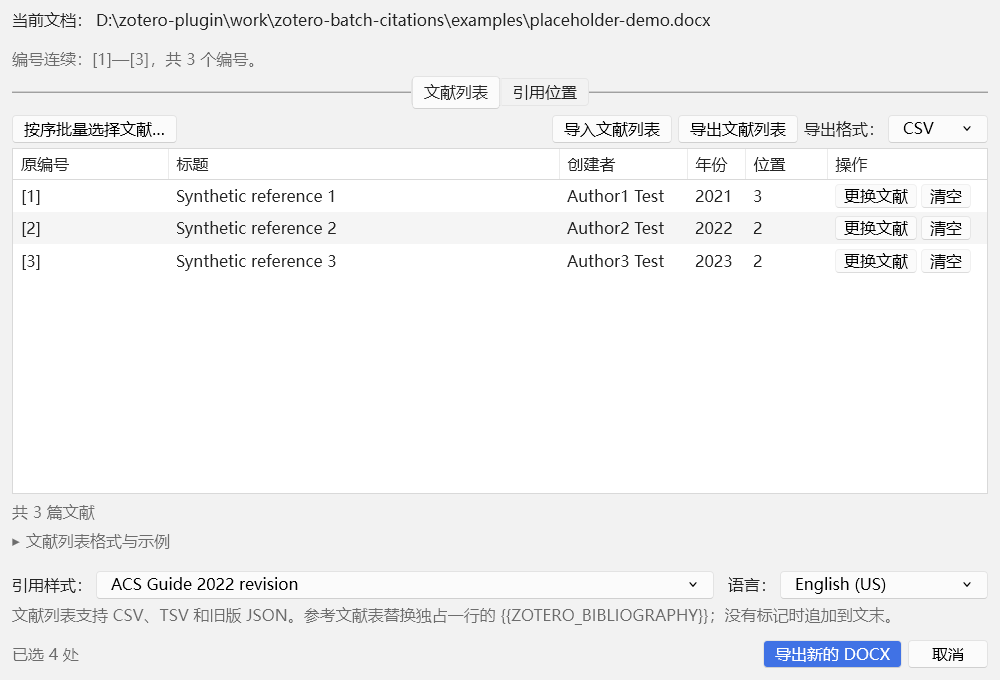
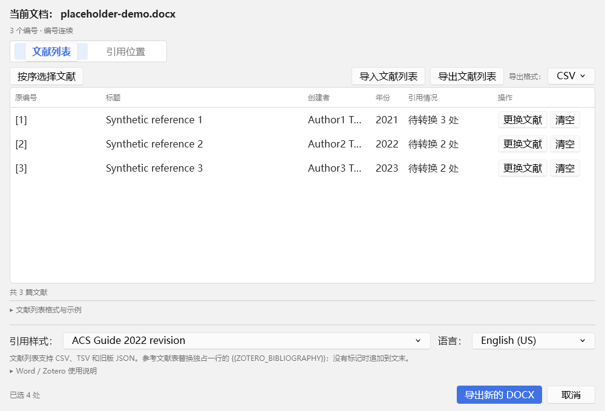
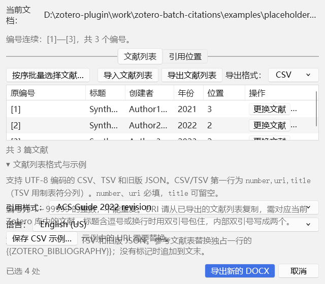
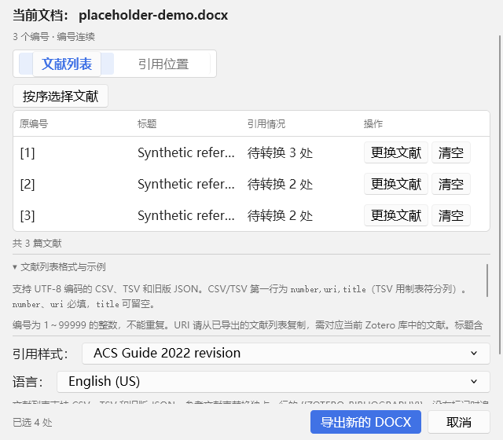
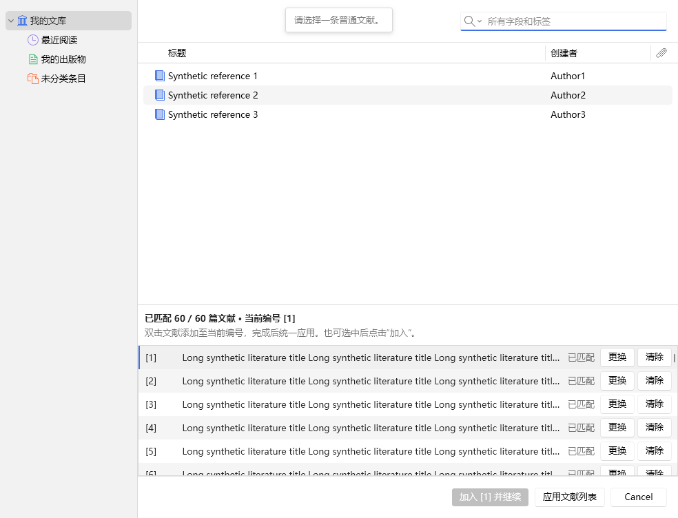
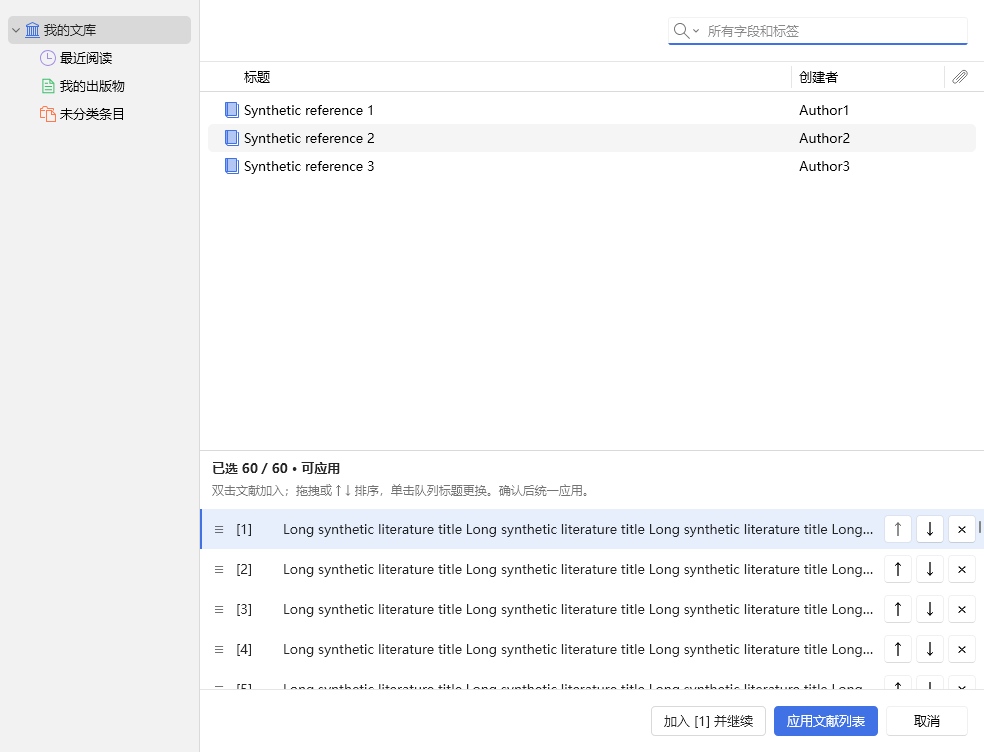
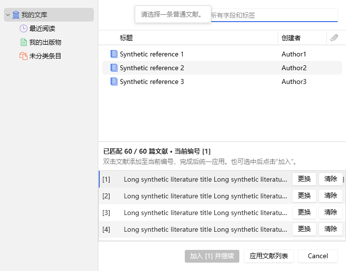
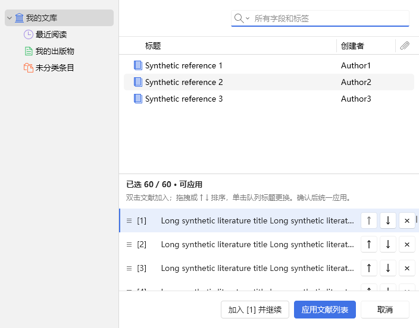
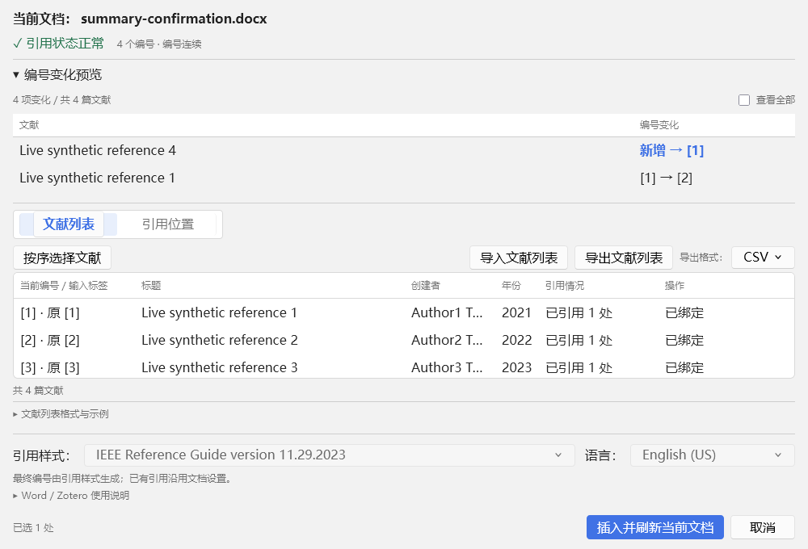
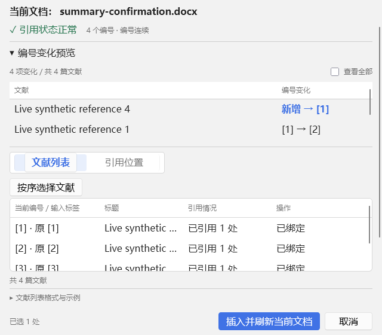

# 1.1.6 开发与验收报告

状态：已完成本地开发与验收，目标版本 1.1.6。成品位于 `outputs/候选版本/1.1.6/`，源码包与验证材料位于 `outputs/开发资料/1.1.6/`。没有发布、推送远程仓库或切换正式版本目录。

## 1　修改摘要

- “引用情况”替代文献列表的“位置”，显示已引用、待转换及混合数量；“引用位置”选项卡与位置状态列保持各自语义。
- 编号预览改为文献标题与变化两列，默认筛选实际改号、新增及无法确认来源的条目；“查看全部”检查未变文献。主窗口和最终确认使用同一数据与渲染函数。
- 主窗口分为文档信息与状态、可折叠编号预览、工作区、引用配置与最终操作四部分。主要操作、导入导出、表格状态和帮助各有明确位置。
- 按序选择新增拖拽、插入位置提示、上下移动，保留双击加入、单项选择、标题更换、清除、取消和最终应用。
- 原生字体、XUL 菜单与按钮、Zotero 检索树及主题保留。共用 `ui-common.css`，默认采用宿主配色，不照搬参考图中的黑色胶囊按钮。

## 2　原“位置”字段的实际含义

原实现有两条渲染路径，不能把所有数字理解为同一种位置数：

| 原显示与模式 | 实际来源 | 1.1.6 展示 |
|---|---|---|
| DOCX 兼容模式的数字 | `archive.scan.occurrences` 中 `eligible` 且包含当前输入编号的候选数量 | 待转换 N 处；零值显示 — |
| Word 模式的“已有 N” | 当前引用状态中该文献的 `ref.occurrences`，按 `citation.citationID` 去重 | 已引用 N 处 |
| Word 模式的“待转 N” | 所有可转换手写候选中包含该输入标签的位置数 | 待转换 N 处 |

已有引用中的一篇文献可出现在多个引用域；同一域内重复条目不重复计数。相同文献对应多个手写标签时，本版按当前映射汇总其待转换位置，同一个组合标记最多计为一处。尚未指定文献的输入行按自身标签统计。

统计包含尚未勾选的位置，不是本次提交数量。正式引用行和待匹配输入行仍分别保留；同篇文献的两行可以显示相同的汇总状态，不能把两行相加当作不同文献。URI 等价关系沿用项目既有身份判断。

这列原本由扫描与引用状态生成，显示值不参与位置定位、转换或编号映射。本版的 `reference-status.js` 只读这些数据，不修改真实计数、扫描对象、Word 范围或 Zotero 元数据。缺乏确定的文献对应关系时仍由原有来源确认和提交检查阻止误写。

## 3　主窗口与子窗口

主窗口的状态使用简洁图标、常规字号和自动换行；编号数量与连续性并排显示。主窗口预览表格最大高度为 `min(15vh, 112px)`，短窗口另受 100px 上限约束，内容内部滚动，不再把所有未变项铺开。标签页直接关联工作区，按序选择位于左侧，辅助导入导出位于右侧，窄窗口自动换行。

文献表格占主要可用空间，标题省略并保留完整提示；窄窗口优先保留编号、标题、引用情况和操作，创建者、年份在放宽窗口后恢复。状态栏在表格下方；格式帮助是独立折叠区域，内容可滚动且可保存模板。引用样式与语言单独成行，长兼容说明移入帮助。操作按钮始终在窗口底部；长警告与多个展开区域同时出现时，主内容可补充滚动，避免区域互相覆盖。

按序窗口保留上方原生检索和文献树，下方队列只展示拖拽柄、编号、主要标题及图标操作。点击标题或用键盘激活标题可更换文献；完整标题仍在提示中。队列独立滚动，重渲染保留滚动位置，并把焦点送回刚移动的文献。取消按钮显示中文。帮助区高度使用 ResizeObserver 和显式状态类同步，兼容 Zotero 7，避免依赖其尚未启用的 CSS `:has()`。宿主字号继续继承，本机实际为 16px；没有为窄窗口整体缩小字号。

## 4　排序实现与提交边界

`OrderedSession.move(fromNumber, toNumber)` 是拖拽和上下移动的唯一排序入口。它先验证端点和整段锁定状态，再按移动后的槽位顺序一次性生成新的编号映射。原标签数组不变；文献记录和空槽一起移动，当前编辑目标跟随对应槽位更新，队列数量不变。

上移、下移分别把目标设为前后相邻槽位；拖拽按指针位于目标行上半部或下半部决定插入边界，换算为同一个目标槽位。拖拽时显示插入线，可在列表边缘滚动。首条上移、末条下移、空槽拖拽，以及移动或跨越已绑定编号均禁用。

排序只作用于 `OrderedSession` 的临时副本。应用前经过既有完整性与文献验证，返回主窗口后仍需用户执行最终插入。关闭或取消选择器返回 `null`，不更新主窗口；重新打开从已经应用的主窗口状态恢复。实时模式允许同篇文献对应多个标签，DOCX 兼容模式沿用唯一性约束。

Word 的物理引用位置、既有引用域、历史标签和 Zotero 文献元数据不由排序方法改写。实际提交继续经过范围、指纹、身份、事务和原生刷新检查。

## 5　测试结果

以下均为本次最终内容的实际验收结果；`tests/verify-delivery.py` 已核对当前源码、各宿主测试 XPI 内容与 Word DLL 校验值一致。

| 检查 | 实际范围 | 通过数 |
|---|---|---:|
| Node 自动测试 | 当前源码；基线为 145 项，本版新增 8 项 | 153 |
| Zotero 原生宿主与 DOCX 兼容流程 | Zotero 7.0.32 / 10.0.7，各自新建隔离资料库 | 各 90 |
| 真实 Word 完整流程 | Word 16.0.20527，与上述两版 Zotero 联测 | 各 43 |
| 文献列表交互子检查 | CSV、TSV、JSON、错误提示、样式、语言与帮助 | 各 30，包含在联测记录中 |
| 官方模板适配与恢复 | 两版官方模板的测试副本 | 各 7 |
| Word 保护、缓存、回滚与撤销 | 最终 DLL，真实 Word COM | 15 |
| Word 引用完整性与最终化 | 同上 | 8 |
| 实际 Word 快照与 JS 计划管线 | 同上，独立于 Zotero 联测 | 8 |

两版 Word 联测均验证：原问题文档副本的 35 个唯一位置、17 个编号及实际转换；普通、重复、组合、表格、密集、无编号与不支持标记；60 篇真实按序加入，随后通过按钮及 DragEvent 调整前三篇顺序，最终原生字段 URI 与排序后的标签映射逐一相符，60 个历史标签保存重开仍可恢复。

两版均验证最终确认与主窗口的变更列表、全部列表一致，取消不写入；接受后只插入一次并刷新；原生文献表及增量更新不重复。混合状态用实际 Word 文档核对“已有 1 个域、2 处待转换”的同一文献，显示为“已引用 1 · 待转换 2”，转换后仍只有原来的两种文献身份。

正常、较窄、最小宽度分别检查主内容区 1000×680、760×600、640×560。每种宽度覆盖两种选项卡及帮助展开/收起；另在真实空数据、不支持标记警告、注入的长阻断错误和展开的编号预览中复验。短窗口可滚动到底部设置，操作按钮保持可见，行按钮完整可读。队列检查 60 行长标题及明暗主题；实际 `devicePixelRatio=1`，不把字体或主题偏好检查表述为真实高 DPI 验收。

测试期间发现并修正了原生标签页面板被挤成半宽、长错误与帮助区互相挤压、Zotero 7 不支持新 CSS 选择器的问题。也修正了测试脚本的旧提示节点选择器和 PowerShell 5 Unicode 字符串断言；失败轮次保留在隔离测试目录，没有计为通过。一个同时启动的全新 Zotero 10 profile 卡在原生样式初始化，改为串行新 profile 后通过；未用该次停滞结果作验收证明。

原问题 DOCX SHA-256 始终为 `b729c2ea9ee879b913907c26915578d941d270fbf657119d97e00816e68d44a0`。测试后注册及原生模板恢复，用户模板字节不变。既有 Git 暂存区保持不变；没有提交或推送。与 1.1.5 正式源码包逐一比较，Word C# 与安装器除版本文字外没有业务变更。

证据入口：[候选输入](test-results/candidate-inputs-1.1.6.json)、[最终一致性证明](test-results/candidate-1.1.6.json)、[完整测试记录](TESTING.md)。原始 profile 位于输入清单所列的新建目录；重跑必须使用新的目录名称。

## 6　真实界面对比

对比取自隔离 Zotero 的实际窗口内容截图，使用合成文献和示例 DOCX；不是设计稿。v1.1.5 来自开发前保存的真实源码，v1.1.6 来自本次候选包。截图文件名中的尺寸是测试目标，实测内容区尺寸在 JSON 中记录。Word 原位工作流的预览和状态另有实际联测截图。

主窗口正常尺寸，内容区 1000×680：

| v1.1.5 | v1.1.6 |
|---|---|
|  |  |

主窗口窄尺寸 640×560，展开格式帮助；旧版的重叠可直接观察：

| v1.1.5 | v1.1.6 |
|---|---|
|  |  |

按序队列正常尺寸，目标外窗 1000×760，实测内容区 984×752：

| v1.1.5 | v1.1.6 |
|---|---|
|  |  |

按序队列窄尺寸，目标外窗 720×560，实测内容区 704×552：

| v1.1.5 | v1.1.6 |
|---|---|
|  |  |

本版还检查了 640px 最小宽度；旧版队列最小宽度为 680px，未把两者错误标为等宽截图。上面四组使用 DOCX 兼容工作流及相同合成数据，便于对比；以下是本版原位 Word 工作流的真实截图：

新版最小队列截图：[640px 队列](images/ui-116-picker-minimum.png)。

## 7　剩余限制

- 本次交付为本地候选包；正式目录仍保留 1.1.5，没有自动发布、远程推送或在用户正式 Zotero 环境安装。
- 当前范围仍为 Windows 桌面 Word 和 Zotero 7/10；没有增加页眉页脚、脚注尾注、批注或文本框批量转换能力。
- 拖拽已在真实 Gecko 窗口通过 DragEvent 验证，物理鼠标整段拖动与所有辅助输入设备仍需区分；不会把合成事件表述为人工鼠标验收。
- 不宣称覆盖所有系统 DPI、系统主题和辅助技术。Word 原生 Refresh 的引用字体行为沿用既有版本。
- 文件选择器在导入导出测试中由确定的测试路径代替；没有宣称完成所有原生文件对话框的人工操作验收。Word/模板恢复、实际文献选择器和引用插入另有独立宿主证据。
- 未重跑所有历史专项故障程序集、全部 CSL 样式及不同 Office/Windows 版本；本轮具体范围以测试表和输入清单为准。
