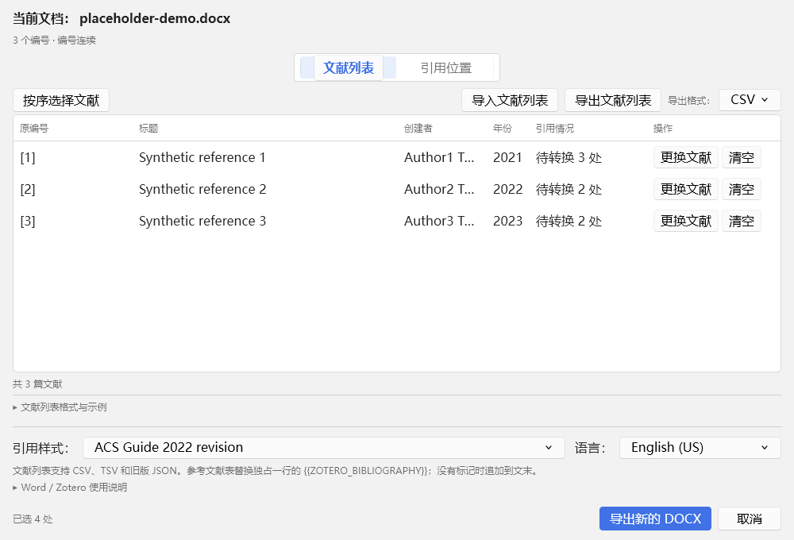
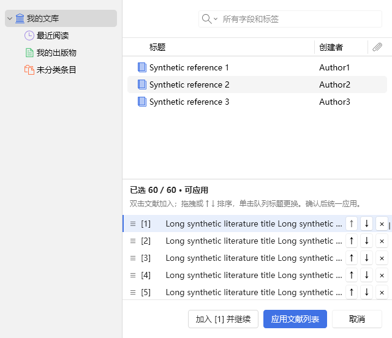

# 1.1.7 开发与交付报告

日期：2026-11-05。唯一维护源码为 `D:\zotero-plugin\work\zotero-batch-citations`；正式交付位于 `D:\zotero-plugin\outputs\当前版本\1.1.7`。发布提交、版本标签、源码及安装包摘要以该目录的 `RELEASE.json` 为准。

## 1　需求对应结果

| 需求 | 实现及检查 |
|---|---|
| 一套当前源码、分离候选与正式版本 | 当前源码原地迭代；`dist`/`bin` 为开发构建，候选、当前正式、历史正式分别管理；源码 ZIP 是不可变交付快照 |
| 保留历史、统一交付流程 | 保存原 Git index 和差异，建立 `baseline/1.1.6-candidate`；正式版本用本地 `vX.Y.Z` 标签；旧测试、构建和正式安装包保留，不推送远程 |
| 打开、复用及恢复窗口 | 更新前台授权时机，使用 Zotero 原生激活及窗口自己的 Windows 句柄；仅恢复最小化状态，首次绘制后重试一次，不永久置顶 |
| 全选只包含完整有效映射 | 所有编号逐一校验；组合和范围缺少任一绑定即跳过整处；清空、条目删除或失效会取消相关选择；提交前及确认后再次核验 |
| 主窗口页签居中 | 两个页签作为一个整体相对工作区居中，保留选中态、间距及窄窗口适配 |
| 按序窗口宽度与高度协调 | 下方列表沿用右侧原生表格容器宽度，排除左侧导航；保留上大下小，行高跟随原生行，标题及按钮垂直居中 |

## 2　引用准确性与既有保护

`selection.js` 统一处理全选、单项可用状态和选择失效后的取消。`[1,2]` 和 `[2–4]` 是完整的位置，不会只转换已绑定的部分。全选提示已选数量、跳过的位置数量和缺失编号；引用位置状态列持续显示缺少的编号。

绑定不仅检查对象是否存在，还检查普通条目类型、未删除状态以及本地条目与 URI 身份是否一致。窗口订阅 Zotero 条目通知，关闭时移除观察者。已有原生引用域所提供的有效内嵌文献沿用原有支持，不强求当前库内存在本地条目。

转换只准备所选位置需要的映射，异步准备及最终确认后再次检查原位置、文档指纹、当前选择和文献身份。DOCX 兼容模式保留跨原编号的文献唯一性检查。没有改动编号语法、Word 原范围、保护边界、原生引用域、协议 3 事务、提交后核验、回滚或撤销机制。

## 3　窗口与布局

Word 在 `start` / `focus` 请求发送前重新调用 `AllowSetForegroundWindow`，避免只在最初入口点击时授权。Zotero 保留原生激活和 DOM focus 的独立回退，通过 `nsIBaseWindow.nativeHandle` 获取目标窗口句柄，检查进程归属后请求前置。仅对最小化状态调用恢复，保留最大化窗口。加载及首次绘制有界重试，不使用永久置顶、模拟输入或持续抢焦点。

后台验收分别记录 Gecko 内部聚焦、Windows 实际前台进程/句柄、窗口可见性、是否最小化、是否置顶和原生函数返回值。它们不能互相替代。Windows 仍可因其他应用获得用户输入等原因拒绝前置；本轮没有控制用户桌面来制造前台授权条件。

本次两版均确认窗口可见、内部聚焦、恢复正常且原生接口无报错；后台测试中两版实际前台均仍为其他应用，`nativeActivation` 与 `exactDialogForeground` 均为 false。因此本轮不宣称已人工验证用户点击入口后的 OS 自动前台成功。

下方队列直接放在原生右侧表格容器中，通过布局自动伸缩宽度，不把导航栏宽度写成固定偏移，也不把一次测量结果冻结为列表宽度。ResizeObserver 仅同步原生行高，并在关闭时释放。实测原生与队列行高均为 28；这是本机宿主测量值，不是写死的行高。

主窗口覆盖 1000×680、760×600、640×560、两个页签、展开帮助和编号预览。按序窗口覆盖 640 / 720 / 1000 的调整请求、明暗主题、160 / 260 的导航栏宽度及 60 行长标题；以最终内容矩形核对左右边界、行高和按钮垂直中心。拖拽排序、上移/下移、锁定屏障、更换、清除、应用和取消均保留回归。

截图来自隔离测试和合成文献；它们只证明对应界面，不替代真实 Word 写入验证。

## 4　实际测试

测试应用为 Zotero 7.0.32 / 10.0.7、Windows 桌面 Word 16.0.20527。只统计 [最终输入清单](test-results/release-inputs-1.1.7.json) 指定轮次；被测 XPI 内容和安装 DLL 必须与正式包一致。完整汇总见 [发布核验记录](test-results/release-proof-1.1.7.json)。

| 检查 | 通过 | 内容 |
|---|---:|---|
| Node 自动回归 | 160 | 含绑定策略、生命周期和发布流程；其中发布流程一项内含 9 个隔离场景，不重复累加 |
| 原生界面、绑定及 DOCX 兼容模式 | 两版各 131 | 组合/范围缺绑定、清空、删除通知、最终校验、兼容模式唯一性、原有文献选择及转换 |
| 主窗口及按序窗口实际几何 | 每版 9 + 18 组，包含在界面记录中 | 工作区居中、宽度与导航变化、行高、按钮和标题不溢出 |
| 真实 Word 完整迭代 | 两版各 43 | 问题文档、60 篇按序匹配、编号映射、实际引用 URI、原生插入/刷新、保存重开、增量及混合引用 |
| 窗口激活及反复打开 | 两版各 67 | 有效原生句柄、可见性、复用、最小化恢复、取消/重开、连续批次和收尾；区分 OS 前台授权结果 |
| 文献导入导出与设置 | 每版 30 个子检查，不重复累加 | CSV / TSV / JSON、错误定位、格式、语言、示例与帮助 |
| 官方模板适配 | 两版原模板各 7 个场景 | 原按钮及 VBA 保留、幂等安装、恢复和更新后修复 |
| 独立 Word 保护、缓存、回滚和撤销 | 15 | 文档变更、修订、受保护范围、注入失败及整批撤销 |
| 独立 Word 引用完整性与最终化 | 8 | 引用组顺序、合并、结构核验和元数据最终化 |
| 独立 Word 实际快照与计划管线 | 8 | JS 计划与真实 Word 快照互验、恢复及刷新提交 |

原问题文档只使用测试副本；35 个唯一引用范围、17 个编号完成真实转换及刷新。原文件 SHA-256 保持为 `b729c2ea9ee879b913907c26915578d941d270fbf657119d97e00816e68d44a0`。60 篇应用经过实际原生选入、按钮和 DragEvent 重排，核对 Word 引用 URI 后刷新并保存重开，不是扫描数量测试。

测试使用隔离 Zotero 资料库、隐藏测试 Word 和临时模板。每次正常联测结束后恢复注册，并读回核对；运行环境原模板和用户官方模板文件保持不变。没有直接点击用户桌面、安装到用户 Zotero 资料库或推送远程。

开发期失败记录保留在 `work/test-runs/active`：

- 队列宽度曾因写回测量像素值而在缩小时不收缩；已改为沿用容器自动布局，并重跑全部几何检查。
- 早期宿主调用及旧检查数量不匹配只影响测试驱动，修正后重新验收。
- 隐藏 Word 不支持应用激活；后台模式改为文档范围操作。窗口关闭后原生集成尚在收尾时，测试等待完整空闲再检查资源释放。
- 一轮从 PowerShell 7 启动 Office 测试而缺少 `GetActiveObject`，在正式用例前中断；测试文档关闭、注册恢复并按 JSON 结构核对。现在入口在改注册前检查 Windows PowerShell。该轮恢复记录为 `test-v7-live117-final/recovery-result.json`。
- 发布反例曾直接覆盖 README 标题，先触发版本结构检查；改为保留版本标题后追加内容，明确验证打包后源码变化会被拒绝。失败 TAP 保存在 `test-node117-dev1`。

这些轮次不计作最终通过。

## 5　交付与历史管理

正式目录中的文件及用途：

| 文件 | 用途 |
|---|---|
| `zotero-batch-citations-1.1.7.xpi` | Zotero 插件 |
| `zotero-batch-citations-1.1.7-word.zip` | 配套 Word DLL、安装/卸载脚本和说明 |
| `zotero-batch-citations-1.1.7-bundle.zip` | 同一 XPI 与 Word ZIP 的合并安装包 |
| `zotero-batch-citations-1.1.7-source.zip` | 当前发布的完整源码快照，排除依赖、Git、测试 profile 和临时构建 |
| `README.md`、`CHANGELOG.md`、`LICENSE` | 使用、升级、变更和许可 |
| `TEST-REPORT.md`、`docs/TESTING.md`、本报告、`docs/test-results` | 交付说明、实际测试与必要原始记录 |
| `RELEASE.json`、`SHA256SUMS.txt` | 版本、提交、源码与交付文件的一致性核验 |

统一流程为版本同步 → Word 编译 → 各层验证 → 证据核对 → 本地提交 → prepare → verify → promote。发布前拒绝未提交源码、旧 DLL、缺失或变化的测试证据和不同内容的安装包；Word 安装脚本、文档、bundle 和源码 ZIP 也逐项对照。正式目录不作为构建目标；切换失败恢复旧目录、候选和入口。

迭代前原暂存内容及差异、155 个旧测试/构建目录的迁移清单位于 `work/archives/release-management-20261105`。1.1.5 旧正式包转入历史目录，1.1.6 保留其候选身份；不删除有价值的历史文件。新版本不再另建可编辑源码副本。[交付规范](RELEASING.md)规定后续版本沿用的命令、目录、标签和回退方式。

旧平铺整理工具已退役，其实现仍可从 Git 基线读取，避免与带核验的正式发布流程并存。

## 6　遗留限制

- 本轮后台测试验证窗口显示、内部聚焦、复用和恢复；没有在用户实际点击 Word 入口的前台环境中进行人工验收。Windows 拒绝前台权限时，不能保证自动抢到前台，逐版实际结果保存在发布核验记录中。
- 实测 DPR 为 1；没有穷尽其他缩放、系统字号、高对比度和辅助设备。没有执行物理鼠标完整拖拽，排序使用实际按钮和 DragEvent 测试。
- 没有穷尽所有 Office、Windows、CSL 样式和复杂字段组合。原位编辑仍限于已测 Windows 桌面 Word 与 Zotero 7/10；其他平台范围沿用现有说明。
