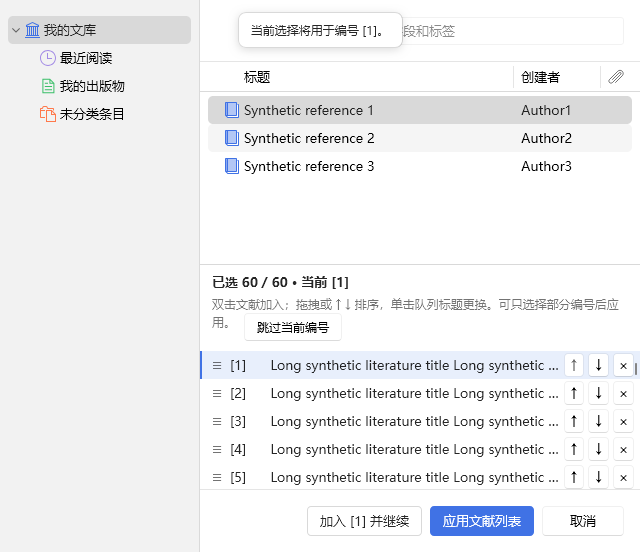
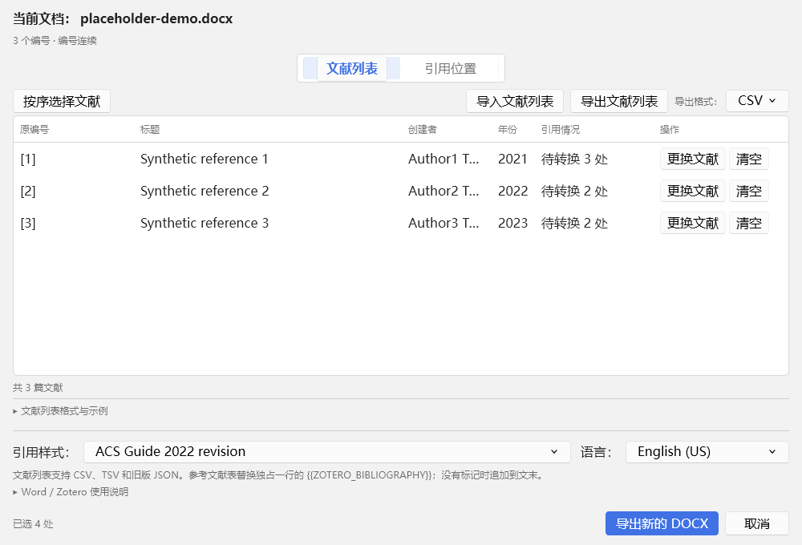

# Batch Citations 1.1.8 开发与交付报告

日期：2026-11-05。维护源码为 `work/zotero-batch-citations`。本版集中修复文献草稿应用、重复绑定和拖拽反馈，统一选择入口；沿用 [正式交付规范](RELEASING.md)。

## 1　部分应用与绑定保护

“应用文献列表”允许只完成部分编号。选择窗口保留打开时的映射快照，应用时返回稀疏变更：新增或替换返回文献，明确清空或排序后腾空的原有位置返回 null；未改变的编号不出现在变更中。主窗口先检查全部变更，再原子应用，并更新文献列表、引用情况、可转换位置及编号预览。

未选择的空槽不会删除已有绑定，队列以外的映射保持原状。已经写入文档的绑定继续受保护；排序不能跨越锁定编号。部分绑定只开放所有相关编号都有效的引用位置，例如仅完成 [1]、[3] 时，[1,2] 仍不可转换。取消不回写；重开显示上一次已应用的结果。

应用前重新解析改变的文献记录。URI 失效等错误展示具体原编号和原因，保持窗口与草稿，允许修正；不存在无提示关闭或静默失败。

## 2　同一文献与不同原编号

不同原编号允许指向同一篇文献。所有选择入口及导入共用身份和确认逻辑，提示文献标题、全部相关原编号、目标编号以及最终编号可能合并的结果。原生确认默认取消，只有明确继续后才接受；取消不删除或覆盖任何旧映射。

文献身份以规范化 URI 为准，支持同一文献的多个历史 URI；两条记录都有 URI 时，不因本地数值 ID 相同而把不同资料库的文献误认成同一篇。应用前和最终转换前重新解析文献时，若库中合并产生新的重复关系，再次确认后才更新映射。已经确认且未改变的关系不会反复提示。

各原编号映射独立保留，Word 原位与 DOCX 兼容转换在同一引用组内按文献身份去重。原位账本优先保留每个未被占用的新原编号，不再因同一文献已经出现而折叠到旧标签；已有不同历史绑定的编号仍需明确确认编号来源，不会被新标签分配覆盖。编号预览与最终引用都合并全部别名及传递关系，例如 [Z]、[A]、[Z,A] 归为一篇；保留最早引用顺序和无关文献，不修改输入记录。最终显示数字仍由 Zotero 和所选 CSL 样式生成。

## 3　统一原生选择窗口与排序

普通“选择文献 / 更换文献”和“按序选择”复用同一个现有 Zotero 原生浏览、搜索和选择窗口，下方使用同一草稿队列；双击或加入先改草稿，应用才回到主窗口。

- 批量模式保留完整队列、跳过、替换、清空、拖拽、上移和下移。连续编号检查沿用原规则；不连续编号可通过定点入口选择。
- 定点模式定位并滚动到指定编号，显示完整队列，但只允许目标编号编辑或清空；邻近编号保持，避免一次单独更换意外重排其他映射。
- 两种模式共用应用、文献解析、重复确认和取消逻辑，没有另建相似的选择窗口。

拖拽在队列层统一计算插入边界。原行上下半区均为合法 move，放回原位置是无变化操作。蓝色插入线由唯一的实际元素渲染；相邻两行的上下半区指向同一个边界，不生成两条线。拖拽穿过队列内部的子元素时保留目标，避免边界短暂消失。拖拽和上下按钮调用同一个原子排序方法，界面与草稿顺序一致。

队列继续沿原生右侧文献表格的宽度布局，并在原生行异步加载后同步行高。保留原生字体、明暗主题、独立滚动及取消行为。

## 4　实际验收

最终应用为 Zotero 7.0.32 / 10.0.7、Windows 桌面 Word。最终轮次和源码对应关系以 [发布输入](test-results/release-inputs-1.1.8.json) 及 [发布核验](test-results/release-proof-1.1.8.json) 为准；旧版、失败和代码继续调整前的轮次均不计入。

| 检查 | 通过 | 内容 |
|---|---:|---|
| Node 自动回归 | 173 | 草稿补丁、定点保护、默认取消、重复身份、传递别名、预览与引用一致性、原有管线及发布反例 |
| 原生界面、绑定与 DOCX | 两版各 159 | 部分/全部应用、保留空槽与旧绑定、取消重开、跳过、替换、清空、导入确认、解析错误及合并重新确认 |
| 主窗口和选择队列几何 | 每版 9 + 18 组，包含在界面记录中 | 正常/窄/最小窗口、明暗主题、160 / 260 导航宽度、60 行队列及原生行高 |
| 真实 Word 完整流程 | 两版各 50 | 问题文档副本、60 篇选入及重排、部分应用、重复绑定、定点补齐、真实引用 URI、刷新和重开 |
| 窗口复用、激活及连续批次 | 两版各 67 | 实际窗口句柄、可见性、最小化恢复、取消重开及收尾 |
| 独立 Word 保护、完整性及管线 | 15 + 8 + 8 | 范围和文档变更保护、事务、回滚、撤销及真实快照 |

原生 DragEvent 检查原位置 move、首尾与相邻边界、一条可见蓝线、拖拽离开子元素、内部顺序和按钮排序。选择期间解析别名变化使用受控的解析器返回值注入；并非把该部分宣称为真实资料库合并操作。无效 URI、资料库删除通知及其他原生行为另有实际宿主回归。

真实 Word 新场景先在原生队列绑定 [1]、[3] 到同一文献，经默认取消的确认框明确继续，跳过 [2] 并应用；只转换两个完整位置，[1,2] 保留。随后重开定点选择为 [2] 补齐，核对已提交的邻近绑定未变，转换剩余位置并执行原生刷新、保存重开。

测试使用隔离资料库和测试副本。真实 Word 脚本拒绝已有 Word 会话，仅暂存本插件三组用户注册项，在测试目录复制并适配官方模板；不修改用户 Startup 模板文件。每轮退出恢复注册并读回核对，原模板哈希必须保持。

开发期失败和调整记录保留在 `work/test-runs/active`：异步确认未结束便再次应用的测试驱动时序已修正；模拟失效文献的用例改用不存在的 URI，避免原生模态窗口内创建/删除测试条目造成通知等待。首轮真实 Word 的部分选择已正确转换，但账本只存一个共享标签，新验收用例因此中断；已修复标签分配，并增加计划、最终化、重开及删除恢复回归。另修复冲突分配可能占用同批后续原编号的边界；保存重开检查按可转换标记计数，原生字段中的受保护数字不再被误算为残留手写引用。Zotero 7 一轮界面检查通过后，默认执行环境曾拒绝只读进程查询；已另行确认测试进程正常退出，不将此查询失败计为界面功能失败。早期真实 Word 调用曾被自动审批拦截；补充只读预检、固定注册范围、模板副本和既有恢复证据后，获准执行最终联测。

## 5　交付与覆盖限制

正式包使用本地干净提交生成，经 prepare / verify / promote 对照被测 addon、Word DLL、源码快照及证据摘要。当前正式目录为 `outputs/当前版本/1.1.8`，原 1.1.7 保留至历史目录；不覆盖旧正式文件，不遗留本轮候选入口，不推送远程。

| 文件 | 用途 |
|---|---|
| `zotero-batch-citations-1.1.8.xpi` | Zotero 插件 |
| `zotero-batch-citations-1.1.8-word.zip` | 同版 Word 加载项与安装、卸载脚本 |
| `zotero-batch-citations-1.1.8-bundle.zip` | 同一 XPI 和 Word ZIP，升级时一并使用 |
| `zotero-batch-citations-1.1.8-source.zip` | 发布源码快照，不作为另一套日常维护工程 |
| `README.md`、`CHANGELOG.md`、`TEST-REPORT.md`、`docs` | 使用、变更、测试与实现说明 |
| `RELEASE.json`、`SHA256SUMS.txt` | 版本、提交、证据和文件摘要 |

未进行物理鼠标完整拖拽和游标图标人工验收；正常拖拽状态由实际原生 DragEvent 的合法目标、默认事件处理和 move 反馈验证。实测 DPR=1，没有穷尽全部 DPI、辅助设备、Windows、Office 和 CSL 组合。后台窗口显示、内部聚焦与 Windows OS 前台授权分别记录，不能互相替代；本轮两版原生接口无错误、窗口可见且恢复正常，但 OS 前台均仍为其他应用，exactDialogForeground 和 nativeActivation 均为 false。未在用户实际点击入口的前台环境人工验收，未自动安装到用户 Zotero 资料库或正式 Word 环境。

