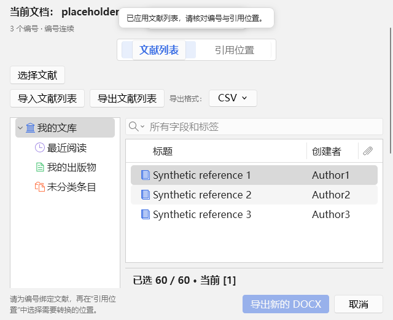
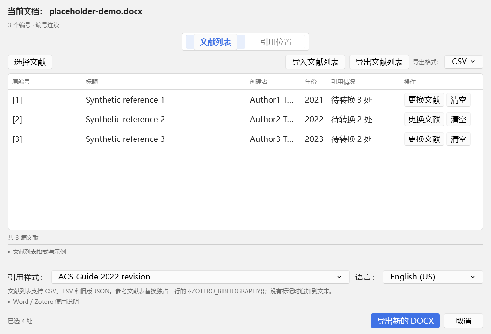

# Batch Citations 1.1.9 开发与交付报告

日期：2026-11-06（验收跨 11 月 5—6 日）。唯一维护源码为 `work/zotero-batch-citations`；沿用 [交付规范](RELEASING.md)。本版将文献选择直接嵌入插件主窗口，修正 1.1.8 仍保留定点受限交互的问题。

## 统一到主窗口

Zotero 原生资料库树、搜索与文献列表直接挂载在主窗口的“文献列表”页。没有独立选择弹窗，没有加载另一个选择网页的内嵌浏览器。主窗口的文档标题、引用状态、编号核对、两页签、导入导出、引用样式、语言与底部操作区继续保留；默认窗口调整至约 1000 × 840（不超过可用屏幕），窄/短窗口通过主内容滚动访问，底部主操作始终可见。选择草稿期间相关写操作暂时禁用，避免草稿与主映射同时改写。

原生资料库导航继承了宿主 `height:5.2em` 的旧样式，造成左上角只显示几行。本版显式取消固定高度，让资料库树随浏览工作区伸展；导航宽度 160 / 260 px 和窄窗口均已验收。宿主还会给 `.toolbar` 注入固定 41px 高度，窄窗口换行时会把第二行按钮压入搜索区；本版显式取消该固定高度并使用两行网格布局，工具栏、搜索区和原生文献表之间各自保持边界，短窗口通过主内容滚动访问完整操作。

展开选择时，下方完整编号队列替代原映射表，保留跳过、单独替换、清空、拖拽、上移与下移。应用或“取消本次选择”后回到原映射表，主窗口保持打开。可切换“引用位置”查看原列表，返回后草稿仍在；保存前不修改原绑定。

## 两个入口的调用

顶部“选择文献”调用局部 `chooseReferences()`；文献行的“选择文献 / 更换文献”调用 `chooseReferences(n)`。二者均调用 `adapter.chooseReferences(numbers,draft,locked,{focusNumber})`，进入同一个 `ZBPicker.open` 内嵌工作区。行入口只决定初始目标编号，不限制其他未锁定行的编辑或排序。

`OrderedSession` 按实际编号推进，不要求编号连续。例如队列 [1]、[3]、[8]，选入 [1] 后直接到 [3]，再到 [8]，不会创建 [2] 或错误重编号；原缺号提示继续保留用于人工核对。默认继续到下一个未完成的可编辑编号，已有绑定不自动覆盖。单击任意未锁定队列标题可定位替换。

每主窗口一份草稿，重复入口复用同一草稿及原生视图，只按需定位，不重置已选文献。`ZBLibrary.mount` 按主窗口复用原生树和搜索，父窗口卸载时注销监听与原生视图。两代 Zotero 分别使用其原生 `changeCollectionTreeRow` / `changeCollectionTreeRows`；选择变化完成事件也保持宿主契约。

## 按钮与状态边界

| 状态 | 可执行操作 | 防止冲突 |
|---|---|---|
| 映射列表 | 选择/更换、导入导出、配置、引用位置及符合条件的转换 | 每处引用仍需全部编号有效 |
| 原生浏览加载 | 查看完整草稿、跳过、清空或取消 | 加入和应用等待资料库就绪 |
| 选择草稿 | 加入并继续、跳过、修改、清空、排序、查看引用位置 | 导入导出、配置、最终转换与主退出暂时禁用 |
| 应用验证中 | 等待结果；文档变化或主窗口关闭可使草稿失效 | 队列编辑、加入、应用和本次取消暂时禁用，迟到结果不写回 |
| 应用失败 | 保留草稿，显示原因，可修正重试或取消 | 不返回不完整补丁 |
| 应用完成 / 取消本次选择 | 恢复原映射表和主窗口操作 | 仅应用保存实际变化；取消不写回 |
| 已写入正文的编号 | 查看；需修改时使用 Zotero 原生引用编辑 | 不允许在队列中覆盖、清空、移动或跨越 |

“加入并继续”不会执行 Word 转换；“应用文献列表”不会写 Word 引用；最终“插入并刷新当前文档”只在草稿结束后执行。主退出与“取消本次选择”作用范围不同，后者只丢弃当前草稿。文档变化会中止旧草稿并刷新快照；切换 Word 文档不能改变提交目标。

## 删除或替换的旧实现

- 删除 adapter 的 `chooseItem`、`chooseItemsInOrder` 两个 API，保留唯一 `chooseReferences`。
- 删除 picker 的 single/batch 标题、提示、编辑限制、定点结束与禁止排序分支；删除 `OrderedSession.mode` / `fixed`。
- 删除 `picker.js` 中 `openDialog(selectItemsDialog.xhtml,...)`、子窗口就绪轮询、子窗口关闭和尺寸管理。文献选择不再创建独立 Window。
- `dialog.xhtml` 新增唯一 `#zbc-reference-workspace`；`library.js` 直接使用宿主原生组件，不复制另一套浏览器。
- 顶部“按序选择文献”统一为“选择文献”，移除缺号禁用规则及错误提示。

此前没有单独的普通 picker.xhtml 文件，因此没有虚构删除该文件。独立窗口的旧实现来自原生选择窗的调用路径与受限模式，本版均已替换。编号预览最终确认和重复绑定确认仍是其原有确认对话框，与文献选择弹窗无关。

## 映射与数据保护

保留初始快照和稀疏修改：未改编号不返回；明确清空返回 null；新增、替换和排序只保存实际变化。应用前重新解析文献并确认新重复关系，主窗口再检查原编号与已提交保护边界，随后原子应用，刷新映射表、引用位置、统计和编号预览。错误展示具体原因并保留草稿；取消完全丢弃草稿。异步验证中若文档变化或父窗口关闭，迟到结果不能应用或再弹确认。

重复文献仍使用同一原生确认，默认取消，展示相关原编号及最终编号可能合并的结果。Word/DOCX 保留所有原编号，引用组按文献身份去重。锁定编号、范围/指纹、事务、恢复、撤销和原生刷新架构沿用，未做无关重构。

## 实际验收

最终轮次由 [发布输入](test-results/release-inputs-1.1.9.json) 指定，[发布核验](test-results/release-proof-1.1.9.json) 对照最终 addon、DLL、测试输出和恢复记录。当前证明使用授权后重新创建的隔离目录；早期 177 项 UI 轮次、工具栏重叠失败轮次和 Zotero 10 激活中断轮次均保留为诊断，不计入最终结果。

| 检查 | 通过 | 证据 |
|---|---:|---|
| Node 自动回归 | 179 | `test-results/unit-tests-1.1.9.tap` |
| Zotero 原生界面、文献绑定、DOCX 与布局 | Zotero 7 / 10 各 189 | `zotero-7.0.32-host-1.1.9.json`、`zotero-10.0.7-host-1.1.9.json` |
| 真实 Word 完整流程 | 两版各 50 | 两份 `zotero-*-iteration-1.1.9.json` |
| 窗口显示、复用、恢复及连续批次 | 两版各 67 | 两份 `zotero-*-activation-1.1.9.json` |
| CSV / TSV / JSON、设置和帮助 | 两版各 30 子项，包含在 Word 记录内 | `literature-io-ui`；不重复累加 |
| 官方模板副本适配及恢复 | 每版 7 场景 | 各宿主 `ribbon/ribbon-result.json` |
| 独立 Word 保护、回滚和撤销 | 15 | `word-safety-1.1.9.json` |
| 独立 Word 引用完整性及最终化 | 8 | `word-integrity-1.1.9.json` |
| 独立 Word 快照与身份管线 | 8 | `word-pipeline-1.1.9.json` |

隔离后台测试 profile 关闭 Windows 窗口遮挡绘制暂停，避免被其他应用遮盖时 requestAnimationFrame 停止；该设置仅用于测试，不写入用户资料库或成品。测试宿主退出按本轮创建的进程对象核对，不查询或操作其他 Zotero 进程。最终两版均为 Zotero 7.0.32 / 10.0.7、Word 16.0.20527、本机 DPR=1，注册项、官方模板和用户模板恢复标志均为 true；窗口可见且原生聚焦正常，但 Windows OS 前台仍由其他应用占用，`exactDialogForeground=false`、`nativeActivation=false`，不能把内部聚焦当作 OS 前台成功。

原生用例通过真实顶部与行按钮，比较相同主窗口、布局、全部队列、排序能力和初始定位；检查没有 `zotero:item-selector` 独立窗口、原生搜索实际筛选/清空、原生视图复用、缺号连续选入、取消不关闭主窗口、部分/全部应用、相邻映射保持、重复确认、拖拽和按钮排序。长队列、窄窗口和原主窗口控件同时核对。

Word 使用隔离 Zotero 资料库、合成文献、问题文档副本及正常 Word 宿主。每轮只临时登记本插件注册项，官方模板使用测试副本，退出读回确认恢复。原问题文档字节必须保持；不安装到用户正式环境。

## 交付与限制

正式本地交付使用干净提交经 prepare / verify / promote 生成 1.1.9；旧正式 1.1.8 原样归档，不覆盖标签、不推送远程、不遗留本轮候选安装包。交付 XPI、同版 Word ZIP、bundle、源码快照、使用说明、测试与校验记录。

拖拽通过实际宿主 DragEvent 验证，未完成人工物理鼠标游标及全部 DPI 验收。实测支持边界为 Windows 桌面 Word 与 Zotero 7.0.32 / 10.0.7；OS 前台授权和内部聚焦分别记录，不能互相替代。未自动安装到用户的 Zotero 资料库或正式 Word 环境。

