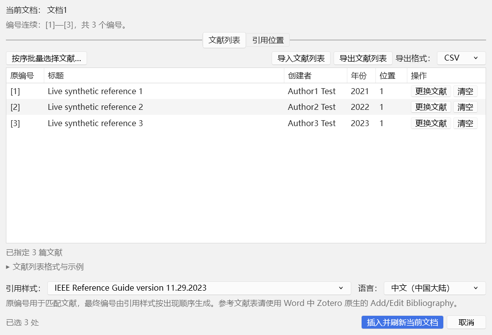
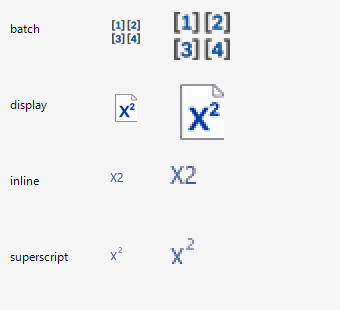

# 测试记录与验收

## 2.0.0

206 项 Node 自动测试、两版各 105 项 Zotero 宿主检查、各 53 项 Word 联动、各 63 项窗口检查和 31 项独立 Word 检查通过。两版实际前台窗口采样通过，测试注册与模板已恢复。环境与结果见 [本版测试报告](DEVELOPMENT-2.0.0.md)。

## 1.1.13 双击绑定修正 · 2026-11-06

单击 Zotero 原生文献树只改变高亮；双击提交到当前编号，Enter 确认当前项，方向键和搜索输入不提交。编号队列整行目标切换、即时稀疏映射、重复复用确认和 Word 写入边界保持不变。

| 检查 | 实际结果 | 证据 |
|---|---:|---|
| 双击、单击浏览、Enter 确认及重复通知 | 206 / 206 通过 | [本版 TAP](test-results/unit-tests-1.1.13.tap) |
| Zotero 7.0.32 原生界面与引用流程 | 105 项通过 | 本版隔离宿主记录 |
| Zotero 10.0.7 原生界面与引用流程 | 105 项通过 | 本版隔离宿主记录 |
| Word COM、临时注册与模板恢复 | 两版各 53 项通过 | 本版 Word 记录 |
| 窗口生命周期、激活与恢复 | 两版各 63 项通过 | 本版激活记录 |
| 版本一致性、源码 / DLL / 测试包哈希及交付证据核验 | 通过；1.1.13 addon `6210371a…6a00e99`，Word DLL `b3760ef1…d6ce108a` | [发布核验记录](test-results/release-proof-1.1.13.json) |

两版隔离 Word 回归实际加载的 DLL 均为 `b3760ef19f0764bc44c58038c50af501969c22dc66ceb20083a7de7fd6ce108a`；Word 16.0.20527 的两轮均通过 53 项，测试源文档未修改，注册和模板均恢复。窗口激活回归各通过 63 项；后台运行中窗口可见、内部聚焦正常且无 API 错误，但系统前台被其他应用占用，OS 前台激活未验证通过。最终核验摘要见 [release-proof-1.1.13.json](test-results/release-proof-1.1.13.json)。

## 1.1.12 开发源码验证 · 2026-11-06

本轮只修正编号详情、整行交互、独立页签及重复绑定。未执行整体回退；保留 1.1.11 的自动映射，局部恢复 1.1.10 页签骨架。1.1.12 的正式状态及安装文件以本版发布清单和“当前版本”目录为准。

| 检查 | 实际结果 | 证据 |
|---|---:|---|
| 完整 Node 自动回归，包含发布工具测试 | 206 / 206，0 失败、0 跳过 | [最终 TAP](test-results/unit-tests-1.1.12.tap) |
| Zotero 7.0.32 隔离原生界面及 DOCX 流程 | 105 项通过 | [宿主记录](test-results/zotero-7.0.32-host-1.1.12.json) |
| Zotero 10.0.7 隔离原生界面及 DOCX 流程 | 105 项通过 | [宿主记录](test-results/zotero-10.0.7-host-1.1.12.json) |
| Word 16.0.20527 真实 COM 回归（Zotero 7.0.32 / 10.0.7） | 每版 53 项通过 | [Word 7 记录](test-results/word-7.0.32-iteration-1.1.12.json)、[Word 10 记录](test-results/word-10.0.7-iteration-1.1.12.json) |
| Word 临时 COM 注册、用户模板及原生模板恢复 | 两轮均通过 | 上述 Word 记录中的恢复状态 |
| Word 窗口复用、恢复及连续批次 | Zotero 7 / 10 各 63 项通过，测试注册和模板已恢复 | 本版发布核验记录所引用的隔离宿主原始结果 |
| 独立 Word 写入安全 / 字段完整性 / 事务管线 | 15 / 8 / 8 项通过 | 本版发布核验记录所引用的独立 COM 测试结果 |
| 版本一致性、18 个 addon JS 语法、XHTML 解析、Word DLL 与插件构建 | 通过 | [源码和被测包核对](test-results/ui-proof-1.1.12.json) |

两代宿主最终轮次均为 `corr-final-o`，使用新隔离 profile、合成资料库和 DOCX 副本。各含两个页签在 1000×680、760×600、640×560 的 6 组实际几何，检查实际显示/命中区域、内部滚动及底部可达；另含上下/左右排列、明暗主题的 12 组几何和 2000 编号/五位目标的 6 组边界。被测 XPI 内容逐项核对最终 addon，SHA-256 为 `2c402809b9d45d9c2b61dffa1e4d01c5c9e8e03dd9b6feb3bef76b35a18d0341`。

原生验收实际触发鼠标按下并等待保存完成，再触发松开、点击与双击激活，确认只绑定一次。覆盖整行选择、删除/排序/替换、重复复用默认取消、自动应用失败与成功重试、无效键盘输入后的程序化重选、资料库删除通知、组合编号全选及输出前 URI 核对。Node 进一步覆盖延迟键盘通知、Enter 重选、快速连续选择、同步导航与异步提交、快照替换、关闭清理及锁定歧义入口。

早期受限执行未能创建临时 Git 元数据、版本文案同步及 XUL 未选页签尺寸断言失败均已定位，最终完整套件和两版 UI 重跑通过；失败轮次保留作诊断。XUL 保留未选页签几何，最终测试核对当前显示与命中面板，不以高度为零推断隐藏。

真实 Word 16.0.20527 使用两套隔离 Zotero profile、合成资料库和新建测试文档，各通过 53 项。覆盖问题文档副本的 35 个位置 / 17 个编号、即时映射不写正文及关闭重开保留、错误/窄窗布局、普通/重复/组合/不支持/密集编号与表格位置、60 篇实际引用写入、部分映射及跨编号重复确认、取消与确认、混合已有引用，以及 CSV / TSV / JSON 界面流程。两版 Word 产生 35 个原生引用域、60 个不同 URI 的完整应用场景；测试源文档 SHA-256 保持不变。

Word 测试先遇到一个过期的布局断言：当前主窗口几何用例覆盖 3 种尺寸 × 2 个页签，旧断言仍要求 9 项。只将测试宿主的期望数修正为 6 后，两版 Word 全流程均通过；插件布局及 Word 插入逻辑未因此改动。另一次受限进程在写入隔离 COM 注册前被权限拒绝，恢复记录核对注册前后相同；随后经授权的两版测试均在结束后确认注册、用户模板和官方模板恢复。

窗口生命周期和独立 Word 检查在最终候选 DLL 上补跑并通过。两个 Zotero 版本的自动前台采样均显示批量窗口可见且无 API 错误，但 Windows 前台仍由另一应用占用，`exactDialogForeground` 与 `nativeActivation` 为 false；因此不宣称通过操作系统前台激活验收。没有使用用户资料库和用户 Word 文档。没有独立 TypeScript 类型检查任务；原生鼠标事件由隔离宿主派发，不等于物理鼠标、全部 DPI 和 Office 组合人工验收。远程推送不属于本轮发布。

## 1.1.11 最终验证 · 2026-11-06

最终证据为两代 Zotero 的 UI `final-c`、真实 Word `final-g`、窗口生命周期 `final-c` 和独立 Word `final-c`。由 [发布输入](test-results/release-inputs-1.1.11.json) 指定，[发布核验](test-results/release-proof-1.1.11.json) 逐文件核对最终 addon、被测 DLL、问题文档基准及临时环境恢复记录。开发失败轮次保留，不计入通过。

| 检查 | 通过 | 证据 |
|---|---:|---|
| Node 自动回归 | 199 | `unit-tests-1.1.11.tap`；0 失败、0 跳过 |
| 原生界面、即时映射、DOCX 与布局 | 两版各 101 | 两份 `zotero-*-host-1.1.11.json` |
| 真实 Word 完整流程 | 两版各 53 | 两份 `zotero-*-iteration-1.1.11.json` |
| 窗口复用、最小化恢复、连续批次 | 两版各 63 | 两份 `zotero-*-activation-1.1.11.json` |
| CSV / TSV / JSON 与备份界面 | 两版各 26 子项，已包含于 Word 记录 | `literature-io-ui`，不重复累加 |
| 官方模板适配及环境恢复 | 每个真实宿主轮次 7 场景 | 原始宿主 `ribbon/ribbon-result.json` 与恢复记录 |
| 独立 Word 保护、回滚与撤销 | 15 | `word-safety-1.1.11.json` |
| 独立 Word 引用完整性 | 8 | `word-integrity-1.1.11.json` |
| 独立 Word 快照与身份管线 | 8 | `word-pipeline-1.1.11.json` |

版本一致性、18 个 addon JavaScript 文件语法及构建检查通过。项目没有独立 TypeScript 类型检查任务。Word 程序集版本为 1.1.11，SHA-256 为 `75b2ae39337c0728d26b032746cbf894cdaacd626c1aaed9556c79a3c9ea212b`；实际宿主和独立 Word 结果均绑定同一 DLL。

即时映射回归覆盖主窗口打开即显示唯一原生资料库及编号队列、无第二编号选择控件和三个旧按钮、编号与标题统一目标、选择即保存、部分映射保持、替换、清除、排序、重复确认默认取消及失败反馈。Node 进一步验证快速连续选择、选择/激活双事件去重、校验或确认期间快照变化、清空项参与排序去重、显式导航保留、目标跟随和父级刷新异常回退。关闭重开相同文档的会话缓存按文档身份和指纹隔离。

真实 Zotero 7.0.32 / 10.0.7 使用独立合成资料库。每版包括上下/左右布局与明暗主题的 12 组几何、2000 编号及当前 [99999] 的 6 组边界、主窗口 9 组几何。实际 DPR=1；1000×680 下两个主要内容区均从 y=142.17 到 y=516.60，高 374.43，顶部和底部实际对齐。两侧内部滚动可用，窄于 720px 时上下排列；小窗口或展开辅助预览时允许有限主区域滚动，底部操作可见。布局切换保留搜索、排序、目标、映射和两列表滚动。

Word 16.0.20527 中，两版均实测选择文献后正文与字段完全不变，关闭重开未变文档仍保留映射，引用位置保持默认不勾选。问题文档副本的 35 个唯一位置 / 17 编号完成原生插入和刷新；另实际完成 60 篇逐项选择、自动映射、按钮/拖拽排序、URI 核对、插入 60 个原生引用域、刷新、保存重开。部分映射、重复标签与组合引用、补齐缺号、最终确认取消及导入导出均通过。不能把这些流程简化为扫描或模拟结果。

原 `textdocx` 基准路径已不存在，本轮从历史原始副本恢复到 `work/test-fixtures/large-document.docx`，SHA-256 为 `b729c2ea9ee879b913907c26915578d941d270fbf657119d97e00816e68d44a0`，与 1.1.10 正式证据一致。只操作测试副本，基准和历史文件未改。各真实宿主轮次的注册、官方模板和用户模板恢复均为 true。

本次两版自动宿主的实际 OS 前台句柄均对应批量窗口，`exactDialogForeground` / `nativeActivation` 为 true，原生接口无错误。这只是本轮自动宿主结果，不代表全部桌面状态。拖拽使用宿主 DragEvent；未进行物理鼠标全程、屏幕阅读器、全部键盘路径、多 DPI 及所有 Office / Windows / CSL 组合人工验收。未安装到用户正式资料库，未远程推送。

尚未写入 Word 的映射在同次 Zotero 运行中保留；跨 Zotero 重启请使用现有导出/导入。开发期布局溢出、空槽排序重复提示及去重/目标跟随问题均补充回归修复；Word 早期失败轮次另有失效基准路径、测试命令路由、辅助预览滚动断言和控制文件并发读取问题，最终 `final-g` 全部重跑通过。实现和截图见 [1.1.11 报告](DEVELOPMENT-1.1.11.md)。

## 1.1.10 最终验证 · 2026-11-06

最终轮次为两代 Zotero 的 `final-a` 隔离宿主。由 [发布输入](test-results/release-inputs-1.1.10.json) 指定，[发布核验](test-results/release-proof-1.1.10.json) 对照最终 addon 文件内容、被测 DLL、原问题文档及恢复记录。开发期失败和代码冻结前轮次保留诊断，不计作正式通过。

| 检查 | 通过 | 证据 |
|---|---:|---|
| Node 自动回归 | 188 | `unit-tests-1.1.10.tap`；发布流程含 11 项独立子场景，不重复累加 |
| 原生界面、选择、DOCX 和布局 | 两版各 109 | 两份 `zotero-*-host-1.1.10.json` |
| 真实 Word 完整流程 | 两版各 51 | 两份 `zotero-*-iteration-1.1.10.json` |
| 窗口复用、最小化恢复、连续批次 | 两版各 63 | 两份 `zotero-*-activation-1.1.10.json` |
| CSV / TSV / JSON、备份入口与界面 | 两版各 26 子项，包含于 Word 记录 | `literature-io-ui`；不重复累加 |
| 官方模板适配与环境恢复 | 每版 7 场景 | 各宿主 `ribbon/ribbon-result.json` 与恢复记录 |
| 独立 Word 保护、回滚和撤销 | 15 | `word-safety-1.1.10.json` |
| 独立 Word 引用完整性 | 8 | `word-integrity-1.1.10.json` |
| 独立 Word 快照与身份管线 | 8 | `word-pipeline-1.1.10.json` |

代码和纯逻辑测试覆盖常驻草稿、空编号、稀疏/锁定编号、应用取消、异步验证迟到成功/拒绝、模态确认期间快照变化、首次/idle/busy live 快照同步，以及编号来源确认后队列一致。发布测试覆盖版本漂移、包/解压安装文件篡改、禁止候选或直接正式构建、旧版归档、发布失败回退。

真实 Zotero 原生窗口使用 65 条合成库文献及 60 行长标题队列，测试上下/左右两种布局、1000×680 / 760×600 / 640×560、明暗主题，共 12 组几何；另有 828 / 840 / 1000px 下 2000 个编号与当前 [99999] 的 6 组边界。连续切换保持原生实例、搜索、资料库行、排序、目标编号、草稿与两列表滚动；尺寸回退恢复、空队列、长标题、新主窗口恢复偏好均通过。两布局切换后验证双击、跳过、拖拽、上移下移、清空及标题替换；部分应用与重复默认取消确认保留。主窗口 9 组几何检查列表、编号详情、配置及底部操作的边界，无横向溢出。

本机 DPR=1，1000×680 的编号队列上下可见 4 行、左右 10 行。640×560 下保留列表最小高度，主内容有少量补充滚动；两个列表仍分别滚动，操作与编号详情不重叠。旧版的 96px 队列上限来自代码检查，未重跑旧版相同数据的完整 A/B 宿主比较。

真实 Word 16.0.20527 对两版 Zotero 均验证问题文档副本 35 个唯一范围 / 17 编号的匹配、确认、插入和原生刷新，首次打开即同步 17 个队列编号；并完成 60 篇实际选入、排序、应用、URI 核对、插入、刷新、保存重开。部分应用、重复标签、最终编号预览、文献表及 CSV/TSV/JSON 往返和错误原子性均通过。原问题文档字节未变；临时注册、官方模板和用户模板恢复均为 true。

本轮两版自动宿主的 actualWindowHandle 均对应批量窗口，exactDialogForeground / nativeActivation 为 true，原生接口无错误。这是本次自动宿主的实际结果；没有人工点击前台验收，也不代表全部桌面、Office 或 Windows 状态。拖拽使用真实宿主 DragEvent，未进行物理鼠标全程、屏幕阅读器、所有键盘路径及多 DPI 人工验收。未安装到用户正式资料库，不推送远程。

实现、文件清单、规则及限制见 [1.1.10 报告](DEVELOPMENT-1.1.10.md)。

## 1.1.9 最终验证 · 2026-11-06

本版最终轮次使用授权后重新创建的隔离 Zotero 7.0.32 / 10.0.7、Windows 桌面 Word 16.0.20527 和文档副本。发布输入、宿主目录、XPI/DLL 身份、恢复记录由 [发布核验](test-results/release-proof-1.1.9.json) 逐项绑定；早期开发轮次和一次工具栏重叠失败轮次不计入。

| 检查 | 通过 | 证据 |
|---|---:|---|
| Node 自动回归 | 179 | `unit-tests-1.1.9.tap` |
| 原生界面、文献绑定、DOCX 与几何 | 两版各 189 | 两份 `zotero-*-host-1.1.9.json` |
| 真实 Word 完整流程 | 两版各 50 | 两份 `zotero-*-iteration-1.1.9.json` |
| 窗口复用、最小化恢复及连续批次 | 两版各 67 | 两份 `zotero-*-activation-1.1.9.json` |
| CSV / TSV / JSON、设置和帮助 | 两版各 30 子项，包含在 Word 记录内 | `literature-io-ui`；不重复累加 |
| 官方模板适配及恢复 | 每版 7 场景 | 宿主目录 `ribbon/ribbon-result.json` |
| 独立 Word 保护、回滚和撤销 | 15 | `word-safety-1.1.9.json` |
| 独立 Word 引用完整性及最终化 | 8 | `word-integrity-1.1.9.json` |
| 独立 Word 快照与身份管线 | 8 | `word-pipeline-1.1.9.json` |

本版实际核对两个入口均在同一主窗口工作区，未创建 `zotero:item-selector`；原生搜索筛选/清空、完整编号队列、缺号连续选择、部分应用、取消、重复默认取消确认、拖拽单插入线、原位置合法放回、上下移动、单独替换、清空和主窗口控件均通过。新增窄窗口断言确保工具栏换行后不会侵入搜索区，完整选择队列和“应用文献列表 / 取消本次选择”可通过主内容滚动触达。

最终宿主测试使用独立资料库、合成文献、问题文档副本和正常 Word；临时 COM 注册项、官方模板副本、用户模板哈希和宿主进程均在每轮结束后恢复。原问题文档字节保持不变。测试窗口可见、内部聚焦正常，但 Windows OS 前台仍可能属于其他应用，相关结果单独记录，不作为插件功能失败或前台授权成功的替代证明。

## 1.1.8 最终验证 · 2026-11-05

本版使用隔离 Zotero 7.0.32 / 10.0.7、Windows 桌面 Word 16.0.20527 和文档副本。最终成功轮次由 [发布输入](test-results/release-inputs-1.1.8.json) 指定，[发布核验](test-results/release-proof-1.1.8.json) 逐项对照最终 addon、DLL、测试输出及恢复记录；失败、旧版及继续修改代码前的轮次不计入。

| 检查 | 通过 | 证据 |
|---|---:|---|
| Node 自动回归 | 173 | `unit-tests-1.1.8.tap` |
| 原生界面、文献绑定及 DOCX | 两版各 159 | 两份 `zotero-*-host-1.1.8.json` |
| 真实 Word 完整流程 | 两版各 50 | 两份 `zotero-*-iteration-1.1.8.json` |
| 窗口显示、复用、恢复及连续批次 | 两版各 67 | 两份 `zotero-*-activation-1.1.8.json` |
| CSV / TSV / JSON、设置和帮助 | 每版 30 子项，包含在 Word 记录内 | `literature-io-ui`；不重复累加 |
| 官方模板副本适配及恢复 | 每版 7 场景，随宿主验收 | 原始目录的 `ribbon/ribbon-result.json` |
| 独立 Word 保护、回滚和撤销 | 15 | `word-safety-1.1.8.json` |
| 独立 Word 引用完整性及最终化 | 8 | `word-integrity-1.1.8.json` |
| 独立 Word 快照与 JS 计划管线 | 8 | `word-pipeline-1.1.8.json` |

新增选择场景验证只完成部分编号也能应用、未改编号保持、显式清空、取消重开、跳过、单独替换及稀疏编号定点选择。重复绑定使用实际原生确认框，默认取消，展示全部相关原编号与可能合并的结果；确认才应用。导入也使用相同确认。实际原生窗口中的应用前 URI 失效会保留草稿并给出编号和原因；应用或转换前资料库合并所带来的别名变化使用受控解析返回值测试，不能将其计作真实库合并操作。

真实 Word 新用例先把 [1]、[3] 明确绑定同一篇，跳过 [2]，仅转换两个完整位置并保留 [1,2]。核对两处实际域 URI、一项最终编号预览及两个独立历史标签；保存重开后使用同一组件的定点模式补齐 [2]，检查邻近已提交映射不变、组合引用保留两篇真实文献、再次刷新及保存重开。另保留问题文档副本 35 个唯一范围 / 17 个编号，以及 60 篇真实选入、排序、应用、Word URI 核对、刷新与重开的完整流程。原问题文件字节保持不变。

拖拽通过实际宿主 DragEvent 核对原位置上下半区均为 move、放回不改顺序、相邻边界一致且最多一条蓝线、子元素离开不闪烁、首尾和锁定屏障、草稿与界面一致；上移、下移共用排序方法。主窗口每版 9 组、队列每版 18 组实际几何包含窄窗口、明暗主题、导航宽度变化及 60 行长队列；本机 DPR=1。

纯逻辑回归进一步核对所有 URI 与传递别名的预览 / 最终引用一致性；原位账本保留共享文献的各个原编号。当前显示编号与历史编号冲突时，另配标签会避开同批原编号；达到 99999 后只找有效空位，没有空位时明确失败。既有引用、编号来源确认、文档范围与指纹、事务核验、回滚和撤销仍运行原有回归。

每轮真实 Word 测试拒绝已有 Word 会话，仅使用隔离模板副本及文档；暂存本插件固定的三组用户注册项，结束恢复并读回核对。用户 Startup 和隔离运行环境的原生模板文件哈希保持不变。

后台窗口可见、Gecko 内部聚焦与 Windows 实际前台授权分别记录，不能以内部 focus 代替 OS 前台成功。本轮两版窗口可见、恢复正常，原生接口无错误；实际 OS 前台均仍为其他应用，exactDialogForeground 和 nativeActivation 均为 false。未进行用户真实点击入口的前台人工验收，也未进行物理鼠标全程拖拽及游标图标人工验收；不穷尽全部 DPI、辅助设备、Office、Windows 和 CSL 组合。版本只作正式本地交付，未安装到用户资料库，不推送远程。

实现、开发期失败记录、截图和交付说明见 [1.1.8 报告](DEVELOPMENT-1.1.8.md)；复现及发布入口统一见 [RELEASING](RELEASING.md)。

## 1.1.7 最终验证 · 2026-11-05

本版使用隔离 Zotero 7.0.32 / 10.0.7、Windows 桌面 Word 16.0.20527 和测试文档副本。最终轮次见 [发布输入](test-results/release-inputs-1.1.7.json)，被测 XPI 内容、DLL、恢复记录及测试文件摘要由 [发布核验记录](test-results/release-proof-1.1.7.json) 对照当前源码。旧版和失败轮次不计入本节。

| 检查 | 通过 | 证据 |
|---|---:|---|
| Node 自动回归 | 160 | `unit-tests-1.1.7.tap`；发布流程一个用例内含 9 个隔离反例及发布/回退场景，不重复计数 |
| 原生界面、绑定和 DOCX 兼容 | 两版各 131 | 两份 `zotero-*-host-1.1.7.json` |
| 真实 Word 完整迭代 | 两版各 43 | 两份 `zotero-*-iteration-1.1.7.json` |
| 窗口显示、复用、恢复和连续批次 | 两版各 67 | 两份 `zotero-*-activation-1.1.7.json`；OS 前台结果单独记录 |
| CSV / TSV / JSON、格式、语言与帮助 | 每版 30 个子检查，不重复累加 | 真实 Word 记录内的 `literature-io-ui` |
| 官方模板适配与恢复 | 两版原模板各 7 个场景 | 原始测试目录内 `ribbon/ribbon-result.json` |
| 独立 Word 保护、缓存、回滚及撤销 | 15 | `word-safety-1.1.7.json` |
| 独立 Word 引用完整性及最终化 | 8 | `word-integrity-1.1.7.json` |
| 独立 Word 实际快照与 JS 计划管线 | 8 | `word-pipeline-1.1.7.json` |

新增绑定场景覆盖 `[1,2]` / `[2–4]` 缺少任一映射时跳过整个位置、完整后全选、清空后即时取消、资料库删除通知、提交前 URI 失效拒绝，以及兼容模式跨原编号的文献唯一性保护。原生已有引用仍允许有效的内嵌文献。窗口测试核对目标句柄的进程归属、可见性、非最小化、非永久置顶、原生接口无错误，反复打开复用原任务；最小化后恢复同一窗口。

每版真实 Word 流程包含问题文档副本的 35 个唯一范围和 17 个编号，以及 60 篇文献在一个原生窗口内按序选入、按钮/DragEvent 重排、统一应用、核对真实字段 URI、原生刷新和保存重开。已有文献表、增量引用、混合已有/手写引用、编号来源确认与取消保持回归。原问题文件保持字节不变。

主窗口每版 9 组实际几何覆盖 1000×680、760×600、640×560、两个页签及展开内容。按序窗口每版 18 组记录覆盖明暗主题、窄窗口和 160 / 260 导航宽度，检查队列与原生右侧文献表格的左右边界、行高、按钮垂直中心和不溢出。保留上大下小，本机队列行高与原生行高均为 28，实测 DPR=1。

后台验证没有控制用户桌面来制造前台权限。Gecko 内部聚焦、窗口可见与 Windows 实际前台分别记录；当 Windows 拒绝前置时，不能把内部 focus 算作 OS 前台成功。实际逐版返回值、句柄及进程见核验记录的 `hosts[].foreground`。用户真实点击 Word 入口时的前台授权环境未进行人工验收。

本轮两版均显示窗口并通过内部聚焦/恢复检查，原生接口没有报错；实际 OS 前台均保留在其他应用，前置返回值和目标前台句柄匹配均为 false。该限制在交付报告中保留。

最终联测结束后，注册和官方模板均恢复并读回核对。开发期中断、调整及恢复记录见 [1.1.7 开发与交付报告](DEVELOPMENT-1.1.7.md)。未穷尽所有 DPI、字号、辅助设备、Office/Windows/CSL 组合；没有物理鼠标完整拖拽测试，未安装到用户 Zotero 资料库，不推送远程。

复现入口与发布步骤统一见 [RELEASING](RELEASING.md)。Office 宿主测试使用 `powershell.exe`（Windows PowerShell），不要直接在 PowerShell 7 中执行 COM 验收脚本；入口在更改注册前检查运行环境。

## 1.1.6 本地候选最终验证 · 2026-11-05

最终 XPI 内容、Word DLL 和当前源码已由 `tests/verify-delivery.py` 对照核验。原始目录与期望数量见 [候选输入](test-results/candidate-inputs-1.1.6.json)，汇总和源码校验值见 [一致性证明](test-results/candidate-1.1.6.json)。没有正式发布、推送或安装到用户资料库。

| 检查 | 通过 | 证据 |
|---|---:|---|
| 当前 Node 回归 | 153 | `unit-tests-1.1.6.tap` |
| 原生选择器、DOCX、正常/窄/最小窗口、明暗主题 | Zotero 7 / 10 各 90 | 两份 `zotero-*-host-1.1.6.json` |
| Word 原位完整流程与状态、预览、排序、文献表 | 两版各 43 | 两份 `zotero-*-iteration-1.1.6.json` |
| CSV / TSV / JSON、错误定位、样式、语言与帮助子检查 | 两版各 30；见上述联测记录，不重复累加 | `literature-io-ui` 子记录 |
| 官方模板副本的适配与恢复 | 两版各 7 | 原始目录的 `ribbon/ribbon-result.json` |
| 独立 Word 保护、缓存、回滚、撤销 | 15 | `word-safety-1.1.6.json` |
| 独立 Word 引用完整性与最终化 | 8 | `word-integrity-1.1.6.json` |
| 独立 Word 实际快照与 JS 计划管线 | 8 | `word-pipeline-1.1.6.json` |

两版均实际完成 60 篇不同文献的按序加入，使用按钮及 DragEvent 调整顺序，统一应用后核对 Word 中真正的引用 URI，再执行原生刷新、保存重开。混合状态由一份真实 Word 文档验证：同篇文献 1 个已有域和 2 处手写位置，正确显示“已引用 1 · 待转换 2”；不是以截图替代功能验证。

Word 版本为 16.0.20527；Zotero 为 7.0.32 / 10.0.7。主窗口实测内容区 1000×680、760×600、640×560，覆盖帮助展开、空数据、警告、注入的长阻断错误和编号预览；队列覆盖 60 行长标题、首尾箭头、锁定屏障、取消重开、点击/键盘更换及明暗主题。实际 DPR=1，宿主字号为 16px，保留原生字体与设置，没有整体缩小字体。

本轮修复及失败记录、真实新旧截图、未覆盖范围见 [1.1.6 开发与验收报告](DEVELOPMENT-1.1.6.md)。没有进行物理鼠标完整拖拽及所有高 DPI/辅助设备人工验收；原生文件选择器使用确定的测试路径代替。测试后注册和原生模板恢复，原用户文档和既有 Git 暂存区保持不变。

## 1.1.5 最终验证 · 2026-11-04

本节仅记录本版实际运行结果。Word/Zotero 联测使用隔离资料库、合成文献及问题文档副本；未在用户正式环境安装本版。

| 检查 | 实际范围 | 通过 |
|---|---|---:|
| Node 自动测试 | 当前源码，Node 24.16.0 | 145 |
| 真实 Word/Zotero 完整流程 | Word 16.0.20527，Zotero 7.0.32 / 10.0.7 | 各 34 |
| 原生选择器、DOCX 兼容及布局 | 同两版 Zotero，Windows 150% 缩放 | 各 62 |
| Word 保护、缓存、回滚、撤销 | 最终 DLL，真实 Word COM | 15 |
| Word 引用完整性及最终化 | 同上 | 8 |
| 实际 Word 快照与 JS 计划管线 | 同上，独立于 Zotero 联测 | 8 |
| 合并中途异常回滚 | 只在临时程序集注入故障 | 1 |
| 官方模板适配及恢复 | 两版原模板的隔离副本 | 各 7 |
| 原问题文档诊断与反向保护 | 35 个唯一范围、指纹稳定、真实图片改宽可检测、原文件不变 | 1 组 |

每版 34 项覆盖问题文档实际打开和转换、35 个位置与 17 篇文献、默认未勾选、取消/重开不修改、重复编号、逗号和范围组合、不支持语法、80 个连续标记、无编号、同单元格多个编号，以及混合引用和已有参考文献表。问题副本的 35 个位置全部经过原生插入、刷新和提交后核验。

**60 篇完整应用不是扫描测试：** 两版均在同一个原生选择窗口中实际依次选入 60 篇不同文献，点击“应用文献列表”，再由主窗口提交；真实 Word 中得到 60 个不同文献的原生引用域，完成原生刷新、60 个历史标签保存和文档保存重开。选择器的 60 行长标题草稿布局检查另行记录，不用来代替这项完整应用。

每版 62 项包含实际双击/加入、替换、清除、应用与取消、长标题完整提示、60 行独立滚动、720×560 / 1000×760 窗口及说明左侧留白。实际 `devicePixelRatio=1.5`。明暗检查在隔离 profile 中切换 Gecko 宿主主题偏好，同时验证 `prefers-color-scheme` 和原生变量：浅色背景为 `#fff`、深色为 `#1e1e1e`，文字同步变化；不再仅设置窗口的 CSS `color-scheme`。测试后恢复 profile 偏好，没有改变 Windows 系统主题。

编号摘要有 10 项独立测试；包括新增/复用、不变项省略、顺延/提前、交换/缺口、冲突/不确定显示、非数字降级、输入冻结不变，以及 1001 篇文献仍保留全部明细的合并说明。两版实际确认窗口逐行比较主窗口摘要与完整明细，取消不改正文/字段/绑定，确认只插入一次并刷新。

原始 Word 1.1.4 扫描读出 554 条候选、35 个唯一位置，随后 JS 范围检查拒绝重叠。逐段扫描修复后为 35 条/35 处。另定位并修复残留空 Zotero 配置、内嵌图导出标识变化及公式的 Word 位置/字符串索引差异，详见 [实现与验证说明](DEVELOPMENT-1.1.5.md)。原始问题文件 SHA-256 始终为 `b729c2ea9ee879b913907c26915578d941d270fbf657119d97e00816e68d44a0`。

交付 DLL SHA-256 为 `cd70d06dc438d1a8ad04e920fa80d96d1ecf00cf444034c5d5ad9a473755f7e9`，与上述最终程序集检查及两版 Word 联测一致。完整联测后按用户截图只增加了一行说明留白 CSS；发布门禁逐文件确认除此以外功能包没有变化，并由两版最终 62 项界面检查验证交付 XPI。该留白没有重跑 Word 插入管线，避免把纯排版检查描述为引用功能重测。

**开发期失败与处理：**

- 新扫描器首次回归未正确划分内容控件；补充分段保护后，最终 15 项安全检查通过。
- 长标题曾把原生内容撑至窗口外；加入横向尺寸隔离后，小窗口和 60 行检查通过。旧 CSS 明暗模拟未同步宿主配色，已改用实际主题媒体查询检查。
- 问题文档在空配置检查、图形指纹、公式正文校验处依次受阻；保留失败轮次，分别修复后两版均完成实际转换。
- 一轮确认窗口自动化使用被模态窗口暂停的父窗口计时器，另一次 60 项选择驱动未等待原生列表就绪；分别修正测试驱动后重跑。额外主题探测曾因脚本缓存及已无待处理窗口失败，后续在新 profile 中完成真正的主题检查。
- 原始复现及上述失败轮次不计作最终通过；预期故障注入只在确认完整回滚后计作通过。

全部证据入口见 [本版发布输入清单](test-results/release-inputs-1.1.5.json)。测试后两版注册及官方模板均读回恢复一致。原始问题文档未改，正式 Zotero 资料库未使用。

**未执行或未穷尽：** Windows 系统主题本身的切换、其他 DPI/字号组合、高对比度和完整辅助功能、所有引用样式/特殊字段组合，以及 Word 中超过 2000 处候选的整篇实测。2001 候选的拒绝及不截断由 Node 测试验证。当前原位支持范围仍为所测 Windows 桌面 Word 与 Zotero 7/10。

---

## 1.1.4 最终修复验证 · 2026-11-04

本节记录本轮实际结果。所有 Word/Zotero 联测使用独立资料库、合成文献和新文档；正式用户环境未安装本版。下面的历史章节保留原结果，不用于证明 1.1.4。

| 检查 | 实际范围 | 通过 |
|---|---|---:|
| Node 自动测试 | 当前源码，Node 24.16.0 | 128 |
| Word 引用身份、重排、恢复及原生布局 | 正常启动的 Word 16.0.20527 + Zotero 7.0.32 / 10.0.7 | 各 61 |
| 原生选择器与 DOCX 文件兼容 | 两版独立 Zotero | 各 47 |
| Word 引用完整性 | 最终 DLL，真实 Word COM | 8 |
| Word 保护、缓存、回滚与撤销 | 同上 | 15 |
| 实际快照与 JS 计划管线 | 同上 | 8 |
| 合并中途故障回滚 | 临时故障程序集，最终生产代码不包含注入 | 1 |
| Ribbon 图标 OLE 与像素回读 | 最终 DLL | 17 |
| 官方模板适配及恢复 | 两版原模板的隔离副本 | 各 7 |

每版 61 项已包含 25 项原生布局检查。布局检查覆盖两页签、760/1000px、三种字体大小与 CSS 明暗色；没有改变操作系统 DPI/主题。

两种实测引用样式为 IEEE 与“西南交通大学（顺序编码）”。覆盖原 [1] 后插入 H、新标签复用 C、提前再次引用 C、删除重复位置、移动文献、旧标签禁止覆盖、保存重开、官方文献表及增量更新、中断后不重复插入的核验恢复。另对四组提交前 CSL 预览与原生刷新后结果直接比对，全部一致。

候选 DLL SHA-256：`054244cdc2a38789365f529d2dc3253c7e91e4239bc2c31e7584bc10a633a441`。另行从当前源码编译后，308 个方法/构造函数 IL 一致；交付的是实际宿主测试过的候选 DLL。所有 XPI 内容均与测试安装包逐文件相同。

700 段、60 个手写编号的文档重开三次，全量扫描计数保持 1。Zotero 7 首次快照 545 ms，缓存 75/76/62 ms；Zotero 10 首次 341 ms，缓存 60/72/66 ms。纯 JS 1000 域恢复为 27.4/15.4/20.9/20.2 ms；不包含 Word COM 和整窗启动。

真实证据目录由 [发布输入清单](test-results/release-inputs-1.1.4.json)记录。发布脚本检查状态、数量、宿主版本、源码/程序集与 XPI 摘要、模板/注册恢复及用户文档不变性，再核对 XPI、Word ZIP、合并包和源码包。`test01.docx`、`test01_新增前.docx`、`test01_异常.docx` 与修复前摘要一致；Git index 未改变。

**未覆盖的人工验收：** 原生 Add/Edit Citation 与 Document Preferences 的全部按钮、操作系统 DPI/主题切换、完整键盘/辅助功能和所有页码/作者属性组合。合并失败在临时程序集注入，原生刷新失败在测试运行器注入；这不等于穷尽所有断电/崩溃场景。Word COM 管线检查与真实 Zotero 宿主联测分别记录，不互相替代。

仅对已测 Windows Word 和 Zotero 7.0.32/10.0.7 作兼容性说明。脚注/尾注等正文外引用、不能确认顺序编码的样式及不可靠字段会停止批量写入。具体机制、测试限制和失败轮次说明见 [1.1.4 实现说明](DEVELOPMENT-1.1.4.md)。

---

## 1.1.3 发布及早期候选的历史记录

日期：2026-11-03。仅使用项目内独立 Zotero profile、关闭同步的合成资料库和新建 Word 文档。Word 正常启动并加载注册的 COM 加载项；用户原 Zotero 模板文件与项目根目录 test.docx 未改写。每轮保存测试文档、恢复原模板会话和加载项注册，核对摘要及注册读回结果。

### 结果

| 层次 | 环境 | 通过项 |
|---|---|---|
| Node 自动测试 | Node.js 24.16.0 | 62 |
| 原有 Word 完整流程 | Zotero 7.0.32 / 10.0.7 + Word 16.0.20527 | 各 15 |
| Word 自动检查与界面交互 | 同上 | 各 59 |
| 原生文献表重开组合 | 混合编号、未保存、已保存三类文档 | 各 42 |
| 窗口竞态、绑定恢复、焦点和缓存专项 | 两版 Zotero + 真实 Word | 各 37 |
| 原生选择器与 DOCX 兼容导出 | 两版 Zotero | 各 47 |
| Word 保护、回滚和撤销 | 最终程序集 + 真实 Word | 15 |
| 共享标签、原宏保留与模板恢复 | 两版官方模板的独立副本 | 各 7 |
| Ribbon 图标 OLE 回读与像素检查 | 最终程序集的四个真实图片对象 | 17 |

本版证据在 test-results 中名称含 1.1.3 的 TAP 和 JSON；release-inputs-1.1.3.json 指向原始隔离记录。发布脚本验证成功状态、数量、最终 XPI 内容和 DLL 摘要以及环境恢复记录，再打包相同内容。开发轮次和旧摘要不计入当前验收。下表的 62 项 Node 结果是 2026-11-03 的发布历史，不包含 2026-11-04 未发布开发分支。

### 2026-11-04 引用身份与自动重编号开发自测（未发布，非独立验收）

本节只记录开发者在当前工作区实际运行的本轮结果。它不能替代发布验收，也没有证明真实 Zotero 会话中的端到端行为。

| 检查 | 命令/环境 | 本轮结果 |
|---|---|---|
| Node 自动测试 | Node.js 24.16.0，`node --test tests/*.test.cjs` | 93 / 93 通过 |
| Word 文档完整性 | Word 16.0，`tests/word-citation-integrity.ps1`（COM，不启用 Zotero） | 8 / 8 通过 |
| Word 保护、回滚、撤销 | `tests/word-safety.ps1 -AssemblyPath <候选 DLL>` | 15 / 15 通过 |
| 隔离宿主安装与恢复 | `tests/run-host-validation.ps1 -IntegrityOnly` | 完整性 8 / 8；注册、两版模板和正常启动恢复均为 true |

完整性结果：`D:\zotero-plugin\work\test-runs\active\test-citation-identity-candidate\word-integrity\result.json`；候选 DLL SHA-256 `9061EADB56D65DCF1B88225BDE07502E82A004FCDD43889DDAD25FB98D983E78`。隔离宿主记录：`D:\zotero-plugin\work\test-runs\active\test-host-integrity2\host-restoration.json` 与同目录 `integrity-result.json`。

本轮新覆盖：同一文献的重复复用在 Node 计划层允许，已绑定标签不能被普通匹配覆盖；相邻引用合并保留最左域 citationID 和 A,H 顺序；旧 citationID 消失但 URI 仍在时保留历史标签；提交后引用丢失、意外新增和顺序反转进入 `needs-recovery`；暂存绑定经 `Finalize` 才提升，且 `Finalize` 不插入引用域。用户提供的 `D:/zotero-plugin/test01_新增前.docx` 与 `test01_异常.docx` 只读解析，SHA-256 未变化；异常文档中的 H,A 历史顺序不被自动修正。

**未验证**：真实 Zotero 10.0.7 / 7.0.32 与 Word 的端到端提交、官方刷新后的实际 citationID 变化、原生 Add/Edit Citation 对话框的逐按钮操作、两版客户端协议协商、CSL 预览与 T13 的多种缩放/配色/键盘布局、700 段 60 文献性能。不得把上表当作这些项目的通过证据。

### 窗口反复使用与原生文献表

原有 42 项矩阵覆盖 21 处重复/组合编号、未保存、已保存三类文档。每类连续三轮，交叉执行官方文献表首次插入、编辑确认、刷新、两秒原生收尾延迟时立即点击、表内光标/整个选区、取消重开、保存关闭重开与增量引用。核对只有一个文献表、每批只增加预期字段、尾部文字保留，原生锁释放且完成窗口关闭。

1.1.2 的原矩阵在本机通过；补充快速关闭后重开的场景后，实际捕获了“窗口已显示，start 响应仍未回到 Word”时再次打开意图丢失。1.1.3 的 37 项专项把首次响应延迟 1800 ms，并抑制一次取消通知，验证旧任务释放和再次打开。原生文献表后另连续六轮关开。延迟和通知抑制仅存在于测试运行器，不进入成品。

已提交任务不因普通窗口关闭而再次执行；旧完成确认不能关闭新任务窗口。重复点击复用有效窗口，最小化的批量窗口能恢复。

### 绑定与数据一致性

重复引用采用“原编号 [2] 最先出现、CSL 显示为 [1]”的文档，确认恢复依赖原编号记录与字段 URI，而非最终显示序号。删除一处后其余位置仍锁定相同文献；普通匹配、CSV 导入和服务端计划均拒绝覆盖，其他原编号也不能占用该文献。

再次插入仅增加所选字段，所有原编号 [2] 的存活位置仍使用同一 URI；官方刷新保持一个文献表。保存、关闭、重开保留绑定。手工替换引用并官方刷新后，普通匹配暂停，明确确认原编号才恢复；旧版无元数据同样先确认。恢复只写对应关系，不新增或替换字段。此处字段替换由测试构造，官方 Add/Edit Citation 对话框未逐按钮人工验收。

62 项 Node 检查还覆盖 URI 规范化判重、删除全部对应位置后释放绑定、损坏元数据拒绝写入、跨编号冲突、旧组件版本拒绝、事务身份和一次提交约束。

### 自动检查与性能

Word 选择、激活与进程内可访问性事件触发 650 ms 防抖。内容签名未变就停止；编号、字段代码/结果或保护边界实际变化才重扫。首次打开扫描，未改变的同一文档重开复用候选；界面控件状态更新复用本次编号结果。没有持续轮询。

真实 Word 验证键入新增、删除、等长替换及已有引用结果编辑后自动更新；新增或移动位置撤销勾选，切换文档不重定向计划。700 段、60 个编号的合成文档连续三次重开，全量扫描计数保持为 1；新增编号和等长替换使缓存失效。

Word 的后台分页和可访问性事件可能在无人键入时触发轻量签名检查。Zotero 7 首轮专项最后一条因原始检查计数在空闲窗口内变化而失败，其余 36 项通过；原计数未区分事件驱动的签名检查与实际重扫，无法单凭次数认定持续扫描。修正后的专项记录事件、检查、全量扫描及快照更新计数：检查必须有新事件或此前排队事件作为来源，频率受防抖限制，正文不变时不得全量重扫或传送新快照。新的独立专项仍使用相同 XPI/DLL，另行校验环境恢复，发布输入明确保留其来源；没有把失败轮次计为通过。该次复核的空闲窗口中，事件、检查、扫描及快照更新计数均未增长。

本轮 Word 快照计时如下。两版完整计时在各自 word-reliability JSON。这是同文档首扫/缓存的比较，不是所有文档的性能承诺或整窗打开耗时。

| Zotero 版本 | 首次快照（ms） | 三次缓存快照（ms） | 缓存平均耗时下降 |
|---|---:|---|---:|
| 7.0.32 | 2065 | 347 / 314 / 305 | 约 84% |
| 10.0.7 | 953 | 104 / 134 / 136 | 约 87% |

59 项自动交互中，28 项直接在真实 Zotero 窗口验证 CSV/TSV/JSON、BOM、格式选择、错误定位、冲突原子导入、模板、Toast、字体及标签布局。文件选择器用测试路径替换，真实条目选择器由独立宿主回归验证。

### 焦点、选择器与界面

专项记录操作系统前台事件，六轮 Word 调用中资料库主窗口保持最小化，未出现指向主窗口的前台事件。实现只授予前台权限并定向激活批量窗口，不恢复、隐藏或置前资料库。程序化后台调用是否取得前台仍受 Windows 限制，不能把后台验证表述为完整人工点击验收。

47 项原生宿主检查包括：单项接受、真正的原生双击事件、加入后保持同一窗口、队列修改/清空、最终统一应用到主界面、取消丢弃草稿、判重和底部按钮实际坐标。按钮由左至右为“加入 [X] 并继续、应用文献列表、取消”。另检查 760px 和 1000px 两个宽度下两个页签的工具栏边界。

图标沿用 1.1.2 图稿；本轮针对最终 DLL 重新回读 OLE 图片并核对尺寸、透明背景、缓存复用、基线与纸页内边距。没有新增整窗 Word Ribbon 人工视觉验收。

### 原有功能、保护与恢复

15 项 Word 流程覆盖未保存文档原位插入、不生成副本、出现顺序编号、粗斜体保留、重复刷新、光标处文献表、重复文献表保护、上标/正文及偏好、资料库变更、删除后重排、保存重开和增量批次。

15 项安全检查覆盖稳定摘要、旧计划拒绝、修订拒绝、普通域/超链接/内容控件保护、完整回滚、原设置恢复、切换文档不重定向和整批撤销。新增缓存命中、纯格式改变后重开更新完整写入摘要，以及绑定属性写入异常时恢复原元数据。

每版模板 7 项检查确认只有功能区 XML 改变，原按钮、回调、VBA 和其余 ZIP 条目保留；安装幂等、卸载恢复原件，并保留之后的官方更新。测试结束恢复注册和模板会话，原模板文件摘要一致。

### 复现

先保存并关闭已有 Word 会话，使用全新测试名称：

~~~powershell
npm ci --ignore-scripts
npm test
powershell.exe -NoProfile -ExecutionPolicy Bypass -File word-addin\build.ps1
python scripts/prepare-runtime.py acceptance10 --live-test --hold-batch
~~~

使用已配置测试入口的隔离 Zotero 副本启动新 profile，确认 live-status.json 为 ready 后执行：

~~~powershell
powershell.exe -NoProfile -ExecutionPolicy Bypass -File tests\run-host-validation.ps1 -TestDirectory D:\zotero-plugin\work\test-runs\active\test-acceptance10 -BackgroundValidation -NativeTemplate D:\zotero-plugin\work\runtimes\runtime10\integration\word-for-windows\Zotero.dotm
~~~

脚本运行四组 Word 验证并在 finally 恢复环境。对 Zotero 7 使用 runtime7/Zotero_win-x64 对应路径。原生选择器使用不带 --live-test 的新 profile；安全、图标检查分别用 tests/word-safety.ps1 和 tests/ribbon-images.ps1。不得复用历史 profile 或真实资料库。

### 验证边界

- Word 完整流程使用 IEEE / en-US；GB/T 7714、其他语言及全部 CSL 未逐一实测。
- Zotero 7.0.32 和 10.0.7 已验证；未来版本依赖的内部接口可能变化。
- 旧版没有保存原编号，不能可靠反推；恢复必须由用户按原稿明确确认。
- Word 没有通用正文修改事件，第三方宏的全部静默修改路径未覆盖，提交前完整摘要仍阻止旧范围写入。
- 窗口打开期间纯格式编辑会使旧计划被拒绝；重开会更新完整写入摘要。
- 官方单独 Refresh 可能重置上标字体覆盖，可重选编号显示或使用对应 CSL。
- 不适用于 macOS、WPS、LibreOffice、Word 网页版或移动版的原位编辑。

历史结果见 [1.1.2](history/TESTING-1.1.2.md)、[1.1.1](history/TESTING-1.1.1.md)、[1.1.0](history/TESTING-1.1.0.md) 和 [0.2.0](history/TESTING-0.2.0.md)。
