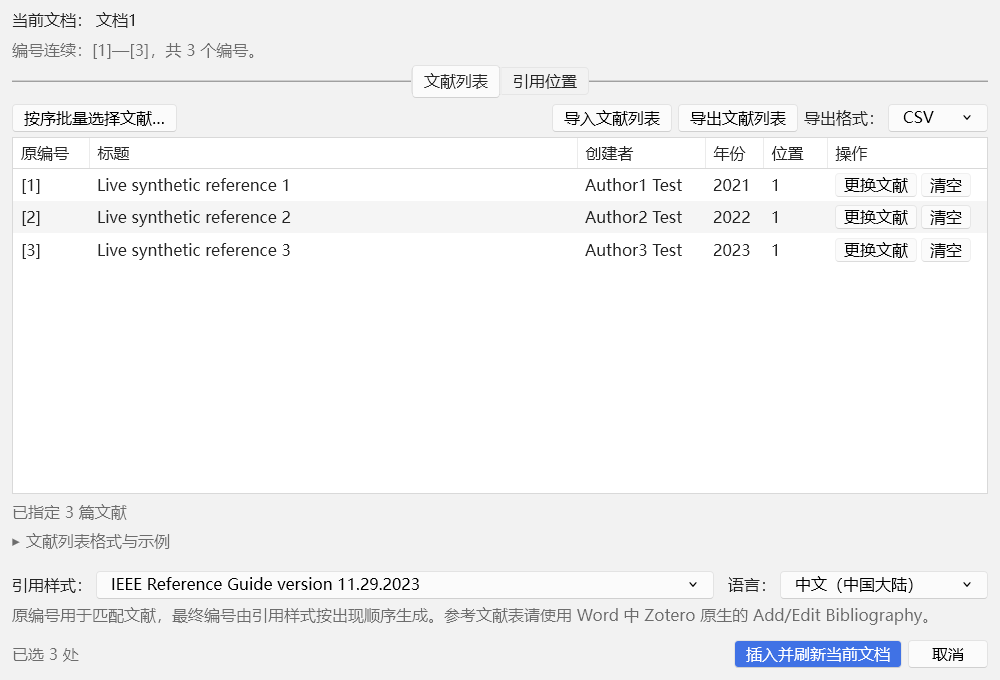

# 编号批量引用 · Batch Citations 1.1.2

在 Windows 桌面 Word 当前文档中，把人工确认的 [1]、[2]、[1,3]、[1–3] 转为 Zotero 动态引用。保留原有编号解析、按序选文献、增量插入、稳定 URI、动态排版和整批撤销。

Word 中直接使用 **Zotero → 批量匹配编号 / 编号显示**。两个入口与 Zotero 原按钮位于同一个标签页，不再增加独立标签；文献表、刷新、引用编辑和引用格式继续使用 Zotero 原按钮。

## 安装或升级

1. 解压 `zotero-batch-citations-1.1.2-bundle.zip`。
2. 在 Zotero 的插件管理器中安装 `zotero-batch-citations-1.1.2.xpi`，替换旧版。
3. 保存并关闭 Word，解压 `zotero-batch-citations-1.1.2-word.zip`，双击 `Install.cmd`。
4. 保持 Zotero 运行，重新打开 Word，在 **Zotero** 标签找到“Batch Citations”组。

请同时升级两个组件。首次使用前需安装 Zotero 官方 Word 插件。安装脚本自动寻找 Word Startup 中的 `Zotero.dotm`，完整备份后，仅把功能区标签改为可共享标识；原按钮、回调和 VBA 宏字节保留。备份与恢复记录位于 `%LOCALAPPDATA%\ZoteroBatchCitations\ribbon`；加载项位于 `%LOCALAPPDATA%\ZoteroBatchCitations\word\1.1.2`。不改 Normal.dotm 或宏安全设置。

Zotero 更新或重新安装官方 Word 插件后，如果标签再次分开，关闭 Word 后重新运行 `Install.cmd`，会为新模板重新备份并适配。自定义 Startup 路径可显式指定：

~~~powershell
powershell.exe -NoProfile -ExecutionPolicy Bypass -File .\install.ps1 -ZoteroTemplatePath 'D:\WordStartup\Zotero.dotm'
~~~

本版支持 Windows 桌面 Word 与 .NET Framework 4.x。验证版本为 Word 16.0.20527、Zotero 7.0.32 / 10.0.7。无自动更新服务器；无需 Node.js、Python、VSTO、PIA、API 密钥或互联网服务即可使用成品。

## 批量匹配编号

1. 打开要处理的 Word 文档，未保存的新文档也可使用。
2. 点击 **Zotero → 批量匹配编号**。也可从 Zotero 工具菜单的“编号批量引用”打开当前 Word 文档。
3. 为原编号选择文献；连续的原编号可在同一个文献窗口依次加入并应用。
4. 勾选确实属于引用的位置。默认不勾选，避免误转数学或数组编号。
5. 新文档选择引用格式和语言；已有引用沿用文档设置。
6. 点击“插入并刷新当前文档”，成功后对应窗口自动关闭，回 Word 查看并保存。可再次打开继续下一批；重复点击入口会前置已有窗口。若 Zotero 正在生成或更新参考文献表，会在原生操作完成后自动打开，并重新扫描当前文档。

同一原编号可反复出现；不同原编号不能指定同一 Zotero 条目。最终编号由 CSL 按出现顺序生成，不保证与手写原编号相同。

## 自动检查与文献列表

打开界面立即检查；Word 中增删或修改引用编号后，以 650 ms 防抖自动重查。检查包括可转换的手写编号及正文中已有的数字型 Zotero 引用，不把文献表编号算作正文引用。导入文献列表、修改对应文献、完成按序选择和批量插入后自动更新结果，无须手动刷新，也没有持续轮询。

文档变化后保留仍适用的文献选择；新增、移动或上下文改变的位置需重新勾选。打开文献选择窗口期间若文档变化，会取消旧选择草稿并更新界面。切换 Word 文档不会把当前计划写到另一份文档。

文献列表默认导出 UTF-8 CSV，也支持 TSV 和旧 JSON。CSV/TSV 第一行为 `number,uri,title`（TSV 用制表符分列）；`number`、`uri` 必填，`title` 可留空。编号是 1～99999 的整数，不得重复；URI 应从已导出的列表复制，并对应当前 Zotero 库中的文献。标题含逗号或换行时用双引号包住，内部双引号写为两个。

界面中的“文献列表格式与示例”可展开说明并保存模板；也可使用随包附带的 [CSV 示例](../../examples/citation-literature-example.csv)。示例 URI 必须替换为真实条目 URI。导入错误会指出行号、字段或缺失的库条目，冲突时整份不应用；旧 `zotero-batch-citations/v1` JSON 继续兼容。需要留存本次列表时，请在插入前导出。

界面使用 Zotero 自带样式、原生标签页、菜单和字体设置。导入、导出和格式选择同排靠右；引用位置的选择按钮在左、提示在右。按钮文字统一双向居中；页签两侧保留与按钮中线对齐的细分隔线，并与下方工具栏分开。格式说明默认折叠。操作反馈为顶部 Toast，自动消失；编号检查结果持续显示在列表上方。

## 编号显示及原生功能

“编号显示”提供“上标编号”“正文编号”，只调整已有数字型 Zotero 引用，偏好随文档保存。Word 中的 Add/Edit Citation、Add/Edit Bibliography、Refresh、Document Preferences 继续使用 Zotero 原按钮。

官方单独 Refresh 可能按 CSL 重置字体覆盖，此时再选择一次编号显示方式，或选用本身符合要求的 CSL 样式。作者年份引用不适用编号切换。参考文献表请在指定光标位置使用 Zotero 的 Add/Edit Bibliography；插件不自动删除手写文献表。

## 范围与数据保护

- 处理主文档正文和表格。已有域、超链接、内容控件及“参考文献 / References / Bibliography”标题后的编号受保护。
- 页眉页脚、脚注尾注、批注和文本框不批量转换；只读、保护、修订开启或尚存修订时拒绝写入。
- 每次最多 2000 处候选、正文最多 5 Mi 字符；单个范围跨度最多 100，单簇最多 200 个编号。
- 写入前重新检查文档身份、完整摘要和原范围；文档变化时停止旧计划。插入异常自动回滚本批修改并恢复原设置。
- 不自动保存、不生成原位操作副本；批量写域可整批撤销。若已写域但官方刷新失败，提示中会说明，可用 Zotero Refresh 重试或撤销。

建议只运行一个 Zotero 实例。原位工作流不适用于 macOS、WPS、LibreOffice、Word 网页版或移动版。

## 文件兼容模式

旧 DOCX 扫描和导出能力保留在 Zotero → 工具 →“编号批量引用：DOCX 文件兼容模式”。它不出现在当前 Word 文档的默认流程中。旧模式导出新副本；用法见 [0.2.0 说明](README-0.2.0.md)。

## 开发与验证

~~~powershell
npm ci --ignore-scripts
npm test
powershell.exe -NoProfile -ExecutionPolicy Bypass -File word-addin\build.ps1
npm run build
~~~

开发使用 Node.js 20+、Python 3、Windows .NET Framework 编译器和 Office 接口元数据。打包生成 XPI、Word ZIP、合并 ZIP、源码 ZIP 和 SHA-256。[测试说明](TESTING-1.1.2.md)记录实际结果和边界；[架构说明](WORD-INTEGRATION-1.1.2.md)记录功能区适配和事件机制。

`npm run build` 默认写入开发用 dist。正式发布运行 `python scripts/release.py`：安装包写入 outputs/当前版本/版本号，源码与配套文档写入 outputs/开发资料/版本号，之前的当前版本归入 outputs/历史版本。outputs/README.md 提供统一入口。

## 卸载

保存并关闭 Word，运行 `Uninstall.cmd`，移除本项目用户注册，并在模板仍与安装时一致的情况下恢复原 `Zotero.dotm`。如果模板已被 Zotero 更新，保留更新后的版本；备份与安装文件均保留。Zotero 端在插件管理器中移除。文档中的标准引用仍可由官方 Zotero 插件管理。

## 许可

本项目 MIT；fflate 的 MIT 许可随包保留。本项目不是 Zotero 官方插件。安装包不分发 Zotero 模板或其 VBA 宏；安装器仅适配用户已有的官方模板。
