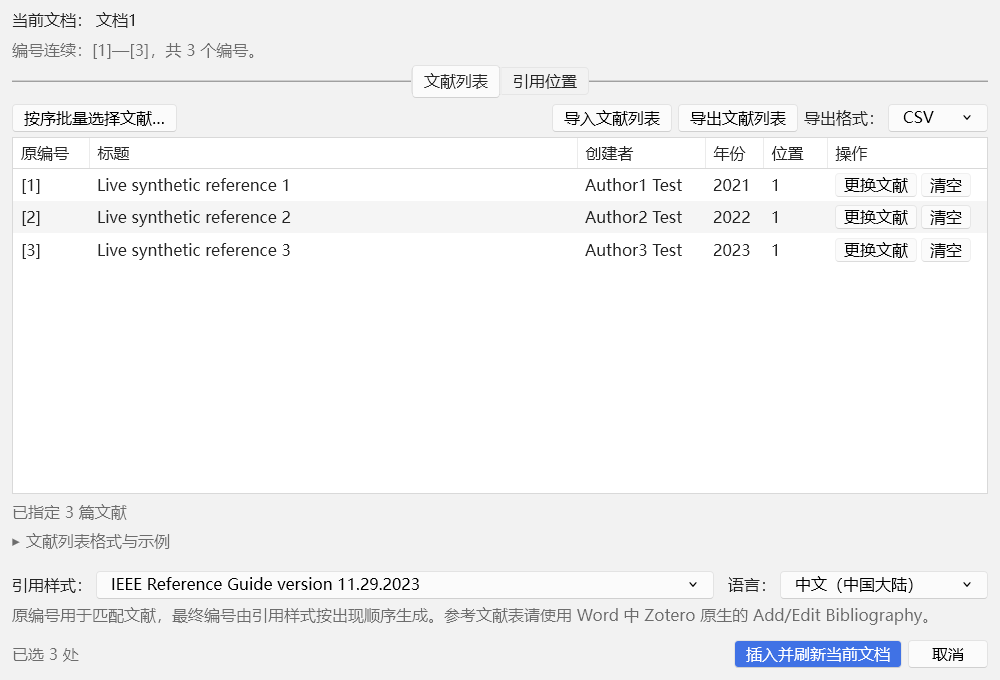
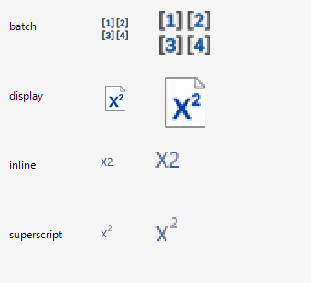

# 1.1.2 测试记录与验收

日期：2026-11-03。仅使用项目内独立 Zotero profile、关闭同步的合成资料库和新建 Word 文档。Word 正常启动并加载注册的 COM 加载项；用户原 Zotero 模板文件与项目根目录 test.docx 未改写。每轮结束后保存测试文档、恢复原模板会话和加载项注册，并核对摘要及注册读回结果。

## 结果

| 层次 | 环境 | 通过项 |
|---|---|---|
| Node 自动测试 | Node.js 24.16.0 | 52 |
| 原生文献表后重开组合 | 混合编号、未保存、已保存三种文档 | 各 42 |
| 原有 Word 完整流程 | Zotero 7.0.32 / 10.0.7 + Word 16.0.20527 | 各 15 |
| Word 自动检查与界面交互 | 同上 | 各 59 |
| Zotero 原生选择器与 DOCX 兼容导出 | 两版 Zotero | 各 45 |
| Word 保护、回滚和撤销 | 最终程序集 + 真实 Word | 12 |
| 共享标签、原宏保留与模板恢复 | 两版官方模板的独立副本 | 各 7 |
| Ribbon 图标 OLE 回读与像素检查 | 最终程序集的四个真实图片对象 | 17 |

本版证据位于 test-results 中名称含 1.1.2 的 TAP 和 JSON；release-inputs-1.1.2.json 指向对应的原始隔离记录。发布脚本验证成功状态、数量、XPI 内容摘要、最终 DLL 摘要及环境恢复记录，随后打包同一内容。

## 重复使用和自动检查

真实宿主中验证：

- 打开当前未保存 Word 文档，立即检查；键入新增、删除、等长编号修改及已有引用域结果编辑后自动更新，650 ms 防抖，空闲时不持续扫描。
- 修改、清空文献、按序选择、导入列表时立即重查；文档变化后保留仍适用的文献映射，新增或移动的位置撤销勾选，切换文档不会重定向当前计划。
- 首次插入、连续三批、取消后重开、全部完成后重开；每批只插入预期数量的引用。
- 重复点击复用并前置已有窗口；最小化窗口恢复；检查 Zotero 内部活动窗口及恢复状态。本轮在后台验证，系统前台由资源管理器保留，未作为新的系统级前置验收。
- 完成后重读最终引用结果并自动关闭对应窗口，释放界面订阅和官方集成状态。隔离测试人为延迟完成确认，立即打开的新窗口不会被旧确认关闭。

59 项中有 28 项直接运行于真实 Zotero 窗口：CSV/TSV 导出和导入、旧 JSON、BOM 与格式选择、缺少表头、非法字段、库中不存在的 URI、冲突导入不部分应用、保存模板、顶部 Toast 和自动消失、原生样式资源与字体、标签切换、说明展开后的布局等。文件选择器使用测试路径替换；原生条目选择器由 45 项宿主回归单独验证。

## 原有功能和数据保护

15 项 Word 回归覆盖未保存文档原位插入、不生成副本、出现顺序编号、相邻粗斜体保留、重复刷新、光标位置文献表、重复文献表保护、上标/正文及偏好、资料库变更刷新、删除后重排、保存重开和增量批次。

12 项安全检查覆盖稳定摘要、格式及文本变化拒绝旧计划、修订拒绝、普通域/超链接/内容控件保护、插入后故障报告、完整回滚、原设置恢复、切换文档不重定向和一次撤销整批。

两版模板各 7 项检查确认：除功能区 XML 外所有 ZIP 条目及 VBA 字节一致；原按钮、回调与共享命名空间保留；安装幂等；卸载可恢复原件；后续官方更新不会被旧备份覆盖；更新模板可重新适配和恢复。

## 界面与图标

主窗口直接加载 Zotero 平台样式，使用原生 XUL 标签和菜单，沿用字体及密度设置；条目选择继续使用 Zotero 原生窗口。测试实际展开菜单、切换标签、展开格式说明并检查控件边界。通过 Gecko 内部绘制保存实际窗口预览，无须桌面截图或鼠标操作。



图标从最终程序集创建的 OLE 图片对象回读，确认 32/16 px 尺寸、透明背景、缓存复用、正文 X2 相同基线及上标数字位置。下图左列为原尺寸，右列为放大查看。



本版在正常 Word 中加载共享模板并核对实际 COM 加载项的 Ribbon XML；没有新增 Word 功能区整窗截图或完整人工视觉验收。1.1.0 的实际可访问性树记录保留在历史测试资料，不充作本版新图标的视觉证据。

## 复现

```powershell
npm ci --ignore-scripts
npm test
powershell.exe -NoProfile -ExecutionPolicy Bypass -File word-addin\build.ps1
python scripts/prepare-runtime.py acceptance10 --live-test --hold-batch
```

新 profile 位于 `work/test-runs/active/test-acceptance10/profile`。隔离运行环境分别位于 `work/runtimes/runtime10` 和 `work/runtimes/runtime7/Zotero_win-x64`；为副本配置测试入口时，使用 `python scripts/instrument-runtime.py ../runtimes/runtime10` 或对应的 Zotero 7 路径。

使用已配置的隔离 Zotero 运行时启动该全新 profile。确认 live-status.json 为 ready 后，在没有其他 Word 会话时运行：

```powershell
powershell.exe -NoProfile -ExecutionPolicy Bypass -File tests\run-host-validation.ps1 -TestDirectory D:\zotero-plugin\work\test-runs\active\test-acceptance10 -BackgroundValidation -NativeTemplate D:\zotero-plugin\work\runtimes\runtime10\integration\word-for-windows\Zotero.dotm
```

脚本正常启动 Word、加载项目内模板副本、运行两组验证，并在 finally 中恢复环境。停止该 Zotero 实例时，在同一测试目录写入 live-control.json，内容为 `{"action":"stop"}`。原生选择器回归使用不带 --live-test 的全新 profile；图标验证使用 tests/ribbon-images.ps1；安全测试使用 tests/word-safety.ps1，并确保不存在其他 Word 会话。不得复用旧测试目录或真实资料库。

原始隔离记录已按版本移至 `work/test-runs/版本号/`，发布输入清单指向新位置。历史日志和 profile 中记录的绝对路径保留当时的值；它们用于核查原始结果，重新运行应生成新的 active 目录。

## 验证边界

- 完整 Word 流程使用 IEEE / en-US；GB/T 7714、其他语言和全部 CSL 未逐一实测。
- 官方引用编辑和文档首选项对话框未逐按钮人工验收；本项目保留原按钮和宏。
- 没有持续轮询。Word 缺少通用正文修改事件，已验证键入、删除、等长替换和域结果编辑；第三方宏静默修改的所有路径未覆盖，提交前仍执行完整摘要校验。
- 官方单独 Refresh 可能重置上标字体覆盖；可再次选择编号显示或使用对应 CSL 样式。
- 原位功能限于 Windows 桌面 Word；其他 Word/Zotero 版本、macOS、WPS、Word 网页版等不在本次验收范围。

历史结果见 [1.1.1](TESTING-1.1.1.md)、[1.1.0](TESTING-1.1.0.md)、[1.0.0](TESTING-1.0.0.md) 和 [0.2.0](TESTING-0.2.0.md)。

## 参考文献表重开矩阵与根因

旧流程在原生文献表窗口关闭、但 cleanup/complete 仍执行时直接拒绝 start，Word 只前置 Zotero。负例稳定复现了 400“Zotero 正在处理其他引用操作”。修复后订阅原生完成 Promise，以单次通知唤醒 Word，重新扫描目标后打开，避免使用收尾前的旧快照；不使用轮询。保存文档还避开旧 ROT 路径，并保留一次性事务校验。

每版 Zotero 的 42 项新增验证采用三类文档：21 处重复及组合编号（含缺号）、未保存文档、已保存文档。每类连续三轮，交叉执行原生文献表首次插入、编辑确认、官方刷新、两秒原生收尾延迟时立即点击、文献表内光标/整个选区、关闭取消后重开、保存关闭重开及再次增量插入；核对仅有一个文献表、每批只增加一处引用、尾部文字仍在、原生锁释放且窗口自动关闭。

原生操作通过 Zotero.Integration.execCommand 执行。延迟仅存在于隔离测试运行器，不进入成品。全部测试以合成资料完成；另曾用项目源文档的独立副本核对混合编号，源文件 SHA-256 保持一致。

Zotero 7 不提供 currentCommandPromise。插件透明观察原生 execCommand 返回的原 Promise，保持参数、this 和返回值，关闭插件时恢复原函数；Zotero 10 同样观察实际原生命令生命周期，并兼容其完成 Promise。该差异有独立回归，不用定时器猜测原生操作何时结束。

主图标来自内置 imagegen 生成的透明原图，源图及提示词见 word-addin/icons/README.md。加载项嵌入原图并在 32px 图标框内等比例绘制；16px 菜单图标维持原尺寸绘制。最终 OLE 回读新增数字 1 竖笔居中和 X² 保留纸页内边距检查，合计 17 项。放大预览采用最近邻以呈现真实像素，不把平滑插值造成的模糊当作实际图标。

原生窗口额外在 760px 与 1000px 两种宽度切换两个页签，检查工具栏位于页签下方、控件左右边界处于窗口内，避免右侧按钮组与中间页签相交。
